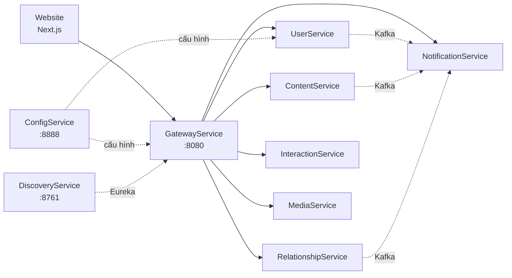

# VINASOCIAL - Nền tảng mạng xã hội theo kiến trúc microservices

> Đồ án phát triển mạng xã hội với **Next.js**, **Spring Boot** và nhiều cơ sở dữ liệu theo miền nghiệp vụ. Người dùng có thể kết nối, chia sẻ bài viết và story, tương tác, nhắn tin; quản trị viên có công cụ quản lý tài khoản và kiểm duyệt nội dung.

---

# Giới thiệu

VinaSocial được xây dựng để tạo một không gian kết nối và chia sẻ nội dung trên web. Thành viên quản lý trang cá nhân, theo dõi nhau, đăng bài, xem bảng tin và trò chuyện. Các chức năng quản trị giúp theo dõi tài khoản, xử lý báo cáo và kiểm duyệt nội dung.

Hệ thống phân tách hai nhóm sử dụng chính:

- **Thành viên:** sử dụng các tính năng mạng xã hội và kiểm soát thông tin cá nhân.
- **Quản trị viên:** quản lý người dùng, bài viết, story, báo cáo và trạng thái kiểm duyệt.

Backend gồm các service độc lập theo miền nghiệp vụ. Website gửi request qua API Gateway; các service trao đổi qua HTTP/OpenFeign hoặc sự kiện Kafka. Dữ liệu của từng miền được lưu riêng, phù hợp với yêu cầu của nó.

---

# Tính năng nổi bật

## Thành viên

- **Tài khoản và hồ sơ:** đăng ký, đăng nhập, đăng xuất, làm mới phiên, khôi phục mật khẩu bằng OTP; xem và chỉnh sửa trang cá nhân.
- **Bảo mật và quyền riêng tư:** bật xác thực hai lớp, quản lý cài đặt riêng tư và thông báo. Hồ sơ trả thông tin khác nhau tùy người xem.
- **Kết nối:** theo dõi, chấp nhận hoặc từ chối yêu cầu theo dõi đối với tài khoản riêng tư, xem danh sách người theo dõi/đang theo dõi, chặn người dùng và quản lý Close Friends.
- **Bài viết và bảng tin:** tạo, sửa, xem bài viết; duyệt bảng tin và nội dung trên trang cá nhân. Giao diện reel dùng luồng bài viết và media hiện có.
- **Story:** tạo và xem story, thiết lập đối tượng được xem; nội dung được lọc theo quyền truy cập và thời hạn.
- **Tương tác:** thích, bình luận và trả lời bình luận, lưu, đăng lại, chia sẻ, ghi nhận lượt xem và báo cáo nội dung.
- **Nhắn tin:** trò chuyện trực tiếp hoặc nhóm, gửi/sửa/xóa tin nhắn, theo dõi trạng thái đã đọc và xử lý một số luồng yêu cầu nhắn tin.
- **Thông báo:** xem thông báo, số lượng chưa đọc, đánh dấu đã đọc hoặc đánh dấu tất cả đã đọc.

## Quản trị viên

- **Quản lý tài khoản:** xem và xử lý dữ liệu người dùng qua giao diện quản trị.
- **Kiểm duyệt nội dung:** quản lý trạng thái bài viết, story và nội dung hiển thị dưới dạng reel.
- **Xử lý báo cáo:** xem các báo cáo do thành viên gửi và thực hiện thao tác quản trị tương ứng.
- **Thống kê:** website có các trang thống kê về người dùng, nội dung và kiểm duyệt; cần đối chiếu nguồn dữ liệu từng biểu đồ khi dùng cho vận hành.

## Bảo mật tin nhắn

Website mã hóa nội dung tin nhắn và tệp đính kèm trước khi gửi. RelationshipService lưu envelope bản mã và quản lý khóa công khai theo thiết bị. Khóa riêng trên thiết bị được bảo vệ cục bộ. Đây là **prototype E2EE**, với phạm vi và giới hạn được trình bày trong [tài liệu triển khai E2EE](docs/E2EE-IMPLEMENTATION.md).

---

# Khám phá chức năng

Sau khi chạy website và các service liên quan, có thể mở trực tiếp các khu vực sau:

| Khu vực | Đường dẫn local | Nội dung |
| --- | --- | --- |
| Đăng ký | `/register` | Tạo tài khoản |
| Đăng nhập | `/login` | Xác thực và vào ứng dụng |
| Bảng tin | `/` | Xem bài viết và story |
| Quan hệ | `/friends` | Theo dõi, yêu cầu và danh sách chặn |
| Tin nhắn | `/messages` | Hội thoại trực tiếp và nhóm |
| Nội dung đã lưu | `/saved` | Xem các mục đã lưu |
| Quản trị | `/admin` | Người dùng, nội dung, báo cáo và thống kê |

Các trang yêu cầu phiên đăng nhập hoặc quyền quản trị sẽ chuyển hướng hay từ chối truy cập nếu tài khoản không đủ quyền.

---

# Thiết kế hệ thống

## Kiến trúc tổng thể



Gateway định tuyến API tới service theo tên đăng ký trong Eureka. ConfigService cung cấp cấu hình tập trung; MonitorAdmin hỗ trợ theo dõi các ứng dụng Spring Boot. Xem [tài liệu kiến trúc](docs/ARCHITECTURE.md) và [sơ đồ luồng nghiệp vụ](docs/business/SEQUENCE_DIAGRAMS.md).

| Thành phần | Trách nhiệm chính | Cổng local |
| --- | --- | ---: |
| Website | Giao diện thành viên và quản trị | 3000 |
| GatewayService | API Gateway, JWT, OpenAPI tổng hợp | 8080 |
| UserService | Tài khoản, hồ sơ, OTP/2FA | 8081 |
| RelationshipService | Theo dõi, chặn, hội thoại, tin nhắn | 8082 |
| ContentService | Bài viết, story, quyền xem và kiểm duyệt | 8083 |
| InteractionService | Thích, bình luận, lưu, chia sẻ, báo cáo | 8084 |
| MediaService | Upload, metadata và kiểm tra media | 8085 |
| NotificationService | Thông báo trong ứng dụng, email/SMS | 8086 |
| DiscoveryService | Eureka service registry | 8761 |
| ConfigService | Spring Cloud Config | 8888 |
| MonitorAdmin | Spring Boot Admin | 8000 |

## Cơ sở dữ liệu theo service

VinaSocial không dùng một cơ sở dữ liệu chung cho toàn bộ hệ thống. Mỗi service nghiệp vụ sở hữu dữ liệu của mình; ID giữa các service là tham chiếu logic, không phải khóa ngoại xuyên database.

| Service | Công nghệ lưu trữ | Dữ liệu chính |
| --- | --- | --- |
| UserService | MySQL | Tài khoản, hồ sơ, cài đặt, OTP |
| RelationshipService | MySQL | Quan hệ theo dõi, hội thoại, tin nhắn |
| ContentService | PostgreSQL | Bài viết, story, trạng thái nội dung |
| InteractionService | MongoDB | Tương tác, lượt xem, báo cáo |
| MediaService | MongoDB + Cloudinary | Metadata và tệp media |
| NotificationService | MongoDB | Thông báo và trạng thái đã đọc |

Xem [sơ đồ và mô tả dữ liệu từng service](docs/database/README.md).

---

# Công nghệ sử dụng

## Frontend

        

## Backend

        

## Database

  

## Hạ tầng và tích hợp

     

Các service backend hiện khai báo Spring Boot **4.0.8**. Phiên bản và dependency cụ thể được khai báo tại [`client/website/package.json`](client/website/package.json) và các file `build.gradle` của từng service.

---

# Cấu trúc dự án

```text
vinasocial/
├── client/
│   └── website/
│       ├── src/app/              # Route auth, social, admin
│       ├── src/components/       # Giao diện theo tính năng
│       ├── src/services/apis/    # API client
│       ├── src/hooks/            # Hook dùng chung
│       ├── src/store/            # Redux store
│       └── src/assets/           # Ảnh và style
├── server/
│   ├── common/                   # Core và security dùng chung
│   ├── ConfigService/
│   ├── DiscoveryService/
│   ├── GatewayService/
│   ├── UserService/
│   ├── RelationshipService/
│   ├── ContentService/
│   ├── InteractionService/
│   ├── MediaService/
│   ├── NotificationService/
│   └── MonitorAdmin/
├── docs/                         # Kiến trúc, API, nghiệp vụ, database
├── bao-cao-vinasocial/           # Báo cáo đồ án bằng LaTeX
└── README.md
```

---

# Hướng dẫn cài đặt

## Yêu cầu môi trường

- **Frontend:** Node.js và npm tương thích với project Next.js.
- **Backend:** JDK 21; mỗi service có Gradle Wrapper riêng.
- **Lưu trữ và sự kiện:** MySQL, PostgreSQL, MongoDB, Kafka tại địa chỉ được cấu hình.
- **Xác thực:** identity provider/OIDC phù hợp với `issuer-uri` của Gateway và các resource server khi dùng API bảo vệ.
- **Tích hợp tùy tính năng:** Cloudinary, SMTP, Twilio/SMS, Zipkin.

## Chạy website

Từ thư mục gốc của source:

```bash
cd client/website
npm install
```

Tạo file `client/website/.env.local` với địa chỉ Gateway:

```dotenv
NEXT_PUBLIC_API_URL=http://localhost:8080
```

```bash
npm run dev
```

Mở [http://localhost:3000](http://localhost:3000). Website có thể lên giao diện trước; các tính năng gọi API cần backend hoạt động.

## Chạy backend

Các service là Gradle project độc lập. Trên máy mới, từ thư mục gốc dự án, xuất bản thư viện dùng chung trước:

```bash
cd server/common
./gradlew publishToMavenLocal
```

Sau khi khởi động database, Kafka và các dịch vụ ngoài cần dùng, chạy theo thứ tự:

1. `ConfigService` tại cổng 8888.
2. `DiscoveryService` tại cổng 8761.
3. Các service nghiệp vụ cần dùng: User, Relationship, Content, Interaction, Media, Notification.
4. `GatewayService` tại cổng 8080.
5. `MonitorAdmin` nếu cần giám sát.

Mở terminal riêng cho từng service. Ví dụ, từ thư mục gốc dự án:

```bash
cd server/UserService
./gradlew bootRun
```

Để build một service, chạy `./gradlew build` trong chính thư mục đó. Không có một lệnh `bootRun` chung tại thư mục `server`.

## Cấu hình dữ liệu và bí mật

Cấu hình tập trung nằm tại `server/ConfigService/src/main/resources/shared/`. Local mặc định dùng MySQL cổng 3306, PostgreSQL cổng 5432, MongoDB cổng 27017 và Kafka cổng 9092. Kiểm tra YAML của từng service để cập nhật host, database, username, password và các biến môi trường tương ứng.

UserService cần khóa AES-256 dạng Base64 để mã hóa OTP; xem [hướng dẫn riêng](server/UserService/README.md). Credential Cloudinary, email và SMS cần được cấu hình cho môi trường chạy. Chi tiết biến môi trường, migration và xử lý lỗi nằm trong [hướng dẫn phát triển](docs/DEVELOPMENT.md).

---

# Hạn chế hiện tại

- Một số tab như bài đăng lại công khai, bài được gắn thẻ và tin nổi bật chưa có API riêng được xác nhận trong source.
- Một số API cho yêu cầu nhắn tin, vai trò thành viên nhóm hoặc danh sách người tương tác chưa có luồng UI đầy đủ.
- Các trang thống kê có giao diện, nhưng cần kiểm tra nguồn dữ liệu và mức độ tích hợp trước khi coi là hệ thống analytics hoàn chỉnh.
- E2EE hiện là prototype RSA-OAEP/AES-GCM: chưa có forward secrecy, xác minh fingerprint/safety number và một số kiểm tra envelope phía server.
- Chạy toàn bộ hệ thống local đòi hỏi nhiều service và hạ tầng; repository hiện chưa có lệnh khởi động chung.

# Hướng phát triển

- Hoàn thiện các màn hình còn thiếu và kết nối đầy đủ với API hiện có.
- Bổ sung kiểm thử tích hợp và luồng khởi động toàn hệ thống để dễ chạy, kiểm tra và triển khai.
- Hoàn thiện thống kê dựa trên dữ liệu backend và trực quan hóa theo nhu cầu quản trị.
- Nâng cấp thiết kế E2EE với xác minh khóa, quản lý thiết bị và cơ chế bảo vệ tin nhắn mạnh hơn.
- Mở rộng trải nghiệm mobile và khả năng vận hành nhiều môi trường.

---

# Tài liệu tham khảo trong dự án

- [Tổng quan tài liệu](docs/README.md)
- [Kiến trúc hệ thống](docs/ARCHITECTURE.md)
- [Hướng dẫn phát triển](docs/DEVELOPMENT.md)
- [Bản đồ API](docs/API_REFERENCE.md)
- [Use case](docs/business/USE_CASES.md) và [sequence diagram](docs/business/SEQUENCE_DIAGRAMS.md)
- [Cơ sở dữ liệu theo service](docs/database/README.md)
- [Xác thực hai lớp](docs/2FA-IMPLEMENTATION.md) và [mã hóa đầu cuối](docs/E2EE-IMPLEMENTATION.md)
- [Báo cáo đồ án](bao-cao-vinasocial/README.md)
