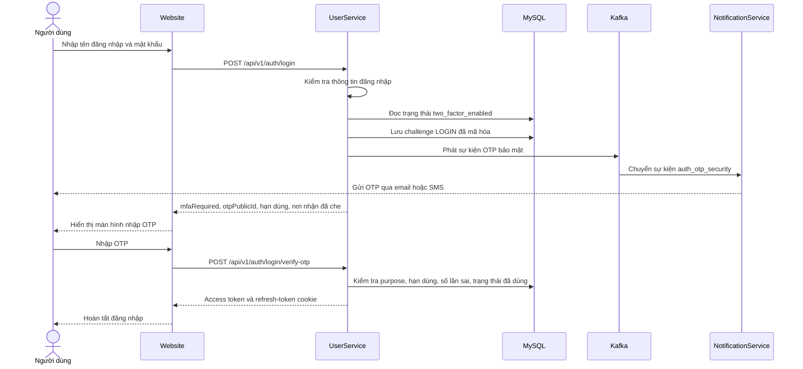

# Quy trình xác thực hai lớp (2FA)

Tài liệu này mô tả luồng 2FA bằng OTP hiện được triển khai trong VinaSocial. Người dùng nhập mật khẩu trước, sau đó xác nhận mã gửi đến email hoặc số điện thoại đã xác minh. Đây là OTP do server tạo; dự án hiện chưa dùng ứng dụng TOTP như Google Authenticator.

## Thành phần

- **Website**: xử lý bước OTP sau đăng nhập và trang bật/tắt 2FA trong phần cài đặt bảo mật.
- **UserService**: xác thực mật khẩu, tạo và kiểm tra OTP, phát hành token, quản lý trạng thái 2FA.
- **Kafka**: chuyển sự kiện OTP bảo mật đến dịch vụ thông báo qua topic `auth_otp_security`.
- **NotificationService**: gửi OTP qua email hoặc SMS.
- **MySQL**: lưu trạng thái 2FA, challenge OTP, thời hạn và số lần nhập sai.

## Đăng nhập khi 2FA đang bật

Nếu tài khoản chưa bật 2FA, `/login` trả token theo luồng đăng nhập cũ. Khi 2FA bật, UserService chỉ trả thông tin challenge ở bước đầu; access token và refresh-token cookie chỉ được cấp sau khi OTP hợp lệ.

Challenge bảo mật chưa xác minh còn hiệu lực (`LOGIN`, `ENABLE_MFA` hoặc `DISABLE_MFA`) được dùng lại nếu người dùng gọi lại endpoint bắt đầu trong thời hạn 90 giây. Lần gọi đó trả cùng `publicId` nhưng không phát sự kiện gửi OTP mới. API gửi lại OTP chung từ chối các purpose bảo mật; người dùng cần chờ challenge hết hạn rồi gọi lại endpoint bắt đầu tương ứng để tạo và gửi mã mới.

## Bật hoặc tắt 2FA

Các thao tác này yêu cầu người dùng đang đăng nhập và nhập lại mật khẩu hiện tại. UserService chỉ tạo challenge nếu tài khoản có email hoặc số điện thoại đang hoạt động và đã xác minh.

1. Website gọi API bắt đầu bật hoặc tắt; UserService xác thực lại mật khẩu.
2. UserService tạo challenge có purpose `ENABLE_MFA` hoặc `DISABLE_MFA`, rồi gửi OTP qua Kafka đến NotificationService.
3. Người dùng gửi `publicId` và mã OTP đến API xác nhận tương ứng.
4. UserService xác nhận purpose và user ID khớp với tài khoản hiện tại, sau đó cập nhật `two_factor_enabled`.
5. Khi bật 2FA, các bản ghi phiên đăng nhập hiện tại bị đánh dấu đã thu hồi nên refresh token không thể tạo phiên mới. Access token JWT đã phát hành vẫn có thể được dùng đến khi hết hạn; cấu hình hiện tại đặt thời hạn access token là 600 giây.

Khi tài khoản bật 2FA, website hiển thị trạng thái trong **Cài đặt tài khoản → Bảo mật tài khoản → Xác thực hai lớp**. Tắt 2FA cũng cần mật khẩu và OTP; sau đó lần đăng nhập tiếp theo không cần OTP.

## API

| Phương thức | Endpoint | Yêu cầu | Mục đích |
|---|---|---|---|
| `POST` | `/api/v1/auth/login` | `identifier`, `password`; tùy chọn `installationId`, `deviceName` | Đăng nhập; nếu bật 2FA thì tạo challenge thay vì cấp token |
| `POST` | `/api/v1/auth/login/verify-otp` | `publicId`, `code`; tùy chọn `installationId`, `deviceName` | Xác nhận OTP đăng nhập và nhận token |
| `GET` | `/api/v1/auth/mfa` | Đã đăng nhập | Đọc trạng thái 2FA |
| `POST` | `/api/v1/auth/mfa/enable` | Đã đăng nhập; `password` | Bắt đầu bật 2FA và gửi OTP |
| `POST` | `/api/v1/auth/mfa/enable/verify` | Đã đăng nhập; `publicId`, `code` | Xác nhận bật 2FA |
| `POST` | `/api/v1/auth/mfa/disable` | Đã đăng nhập; `password` | Bắt đầu tắt 2FA và gửi OTP |
| `POST` | `/api/v1/auth/mfa/disable/verify` | Đã đăng nhập; `publicId`, `code` | Xác nhận tắt 2FA |

Các API quản lý 2FA cần access token. `GET /api/v1/auth/otp/{publicId}` vẫn được dùng để đọc thông tin challenge (không trả mã OTP và che địa chỉ nhận). Các endpoint OTP chung `/verify` và `/resend/{publicId}` không xác minh hoặc gửi lại challenge bảo mật; đăng nhập và bật/tắt 2FA dùng endpoint riêng theo đúng purpose. Hiện chưa có API gửi lại OTP bảo mật.

## OTP và bảo vệ dữ liệu

- OTP gồm 6 chữ số, được tạo bằng `SecureRandom`, có hiệu lực 90 giây và chỉ xác minh một lần.
- Challenge lưu purpose, `publicId`, thời hạn, thời điểm xác minh và `failed_attempts`. Sau 5 lần nhập sai, các lần xác minh tiếp theo bị từ chối; challenge đã xác minh không dùng lại được.
- Khi OTP sai, bộ đếm lỗi được lưu dù request trả lỗi; các service dùng Spring `@Transactional(noRollbackFor = AuthOtpInvalidCodeException.class)` cho trường hợp này.
- So sánh mã dùng `MessageDigest.isEqual`. DTO trả cho client không chứa mã OTP; nơi nhận được che một phần.
- OTP lưu trong `auth_otps.code` được mã hóa AES-256-GCM. Mỗi lần mã hóa dùng IV ngẫu nhiên 12 byte, tag xác thực 128 bit và `publicId` làm AAD. Chuỗi lưu có dạng `v1.<IV-base64url>.<ciphertext-base64url>`.
- Hàm giải mã vẫn đọc được các OTP cũ dạng plaintext để tương thích với bản ghi tồn tại trước khi bật mã hóa; các OTP mới được ghi dưới dạng mã hóa.

## Cấu trúc dữ liệu và migration

Flyway chạy [V2__add_mfa_and_encrypt_auth_otp.sql](../server/UserService/src/main/resources/db/migration/V2__add_mfa_and_encrypt_auth_otp.sql) khi UserService khởi động. Migration này:

- thêm `users.two_factor_enabled`, mặc định `false`;
- thêm `auth_otps.failed_attempts`;
- mở rộng cột `auth_otps.code` để chứa ciphertext;
- cho phép các purpose `ENABLE_MFA` và `DISABLE_MFA` trong constraint của bảng OTP.

Các phần code chính:

- UserService: [AuthController.java](../server/UserService/src/main/java/vn/tuhoc/UserService/controllers/AuthController.java), [AuthServiceImplement.java](../server/UserService/src/main/java/vn/tuhoc/UserService/services/AuthServiceImplement.java), [AuthOtpServiceImplement.java](../server/UserService/src/main/java/vn/tuhoc/UserService/services/AuthOtpServiceImplement.java), [AuthOtpEncryptionServiceImplement.java](../server/UserService/src/main/java/vn/tuhoc/UserService/services/AuthOtpEncryptionServiceImplement.java).
- Website: [AuthApiService.tsx](../client/website/src/services/apis/v1/AuthApiService.tsx), [LoginFormComponent.tsx](../client/website/src/components/auth/LoginFormComponent.tsx), [TwoFactorComponent.tsx](../client/website/src/components/social/profile/edit/TwoFactorComponent.tsx).
- NotificationService nhận topic trong [ConsumerServiceImplement.java](../server/NotificationService/src/main/java/vn/tuhoc/NotificationService/services/ConsumerServiceImplement.java).

## Khóa mã hóa

Khóa phải là Base64 biểu diễn đúng 32 byte. Môi trường phát triển hiện cấu hình khóa trong [application.yml](../server/UserService/src/main/resources/application.yml), nên không phụ thuộc working directory hoặc file cấu hình phụ. Với môi trường dùng chung/production, chuyển khóa vào secret manager và cấp qua `AUTH_OTP_ENCRYPTION_KEY_BASE64`; không commit khóa production. Lớp mã hóa nằm trong [AuthOtpEncryptionServiceImplement.java](../server/UserService/src/main/java/vn/tuhoc/UserService/services/AuthOtpEncryptionServiceImplement.java).

Giữ nguyên cùng một khóa qua các lần khởi động và dùng chung khóa ở các instance UserService. Không commit khóa hoặc tạo khóa mới cho một database đang có challenge đã mã hóa; mất khóa khiến các challenge còn hiệu lực không thể giải mã.

## Giới hạn hiện tại

- Mã OTP được gửi trong payload Kafka ở dạng rõ để NotificationService gửi đi. Mã hóa ở database không mã hóa payload Kafka; môi trường triển khai nên giới hạn ACL, bật TLS và đặt retention phù hợp cho topic.
- Xác thực qua email/SMS phụ thuộc bảo mật của email hoặc SIM, nên yếu hơn ứng dụng TOTP hoặc khóa bảo mật phần cứng.
- Chưa có mã khôi phục hoặc quy trình khôi phục tài khoản nếu người dùng mất quyền truy cập email/số điện thoại.
- Hệ thống chọn một email hoặc số điện thoại đã xác minh và đang hoạt động từ tài khoản; giao diện chưa cho người dùng chọn kênh nhận.
- Challenge đăng nhập gắn với `publicId`, purpose và tài khoản, không gắn với `installationId` tạo challenge. Thông tin cài đặt thiết bị được gửi khi xác minh OTP để tạo phiên đăng nhập.
