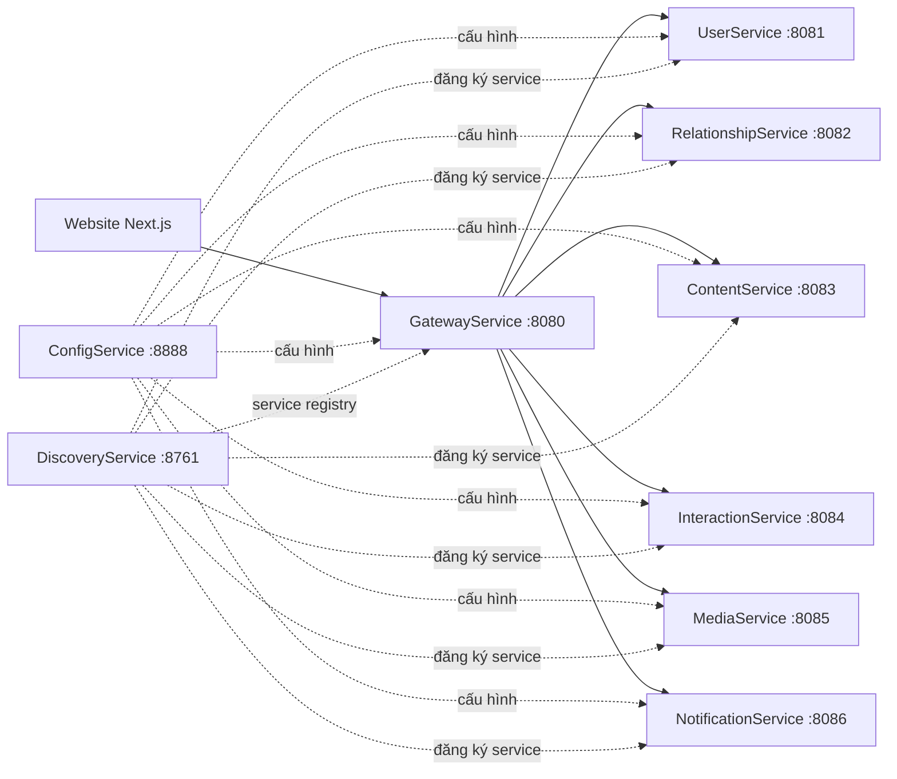

# Kiến trúc VinaSocial

## Tổng quan

Gateway định tuyến theo path bằng `lb://service-name` trong `GatewayService/configs/RoutesConfig.java`. Các service backend dùng ConfigService và Eureka; nhiều luồng giữa service gọi nhau qua OpenFeign hoặc Kafka.

## Website

Ứng dụng đặt trong `client/website` và dùng Next.js App Router, React, TypeScript, Redux Toolkit, TanStack Query, Axios, Ant Design và Tailwind CSS.

- `src/app`: route theo nhóm auth, social, admin và trang lỗi.
- `src/components`: component theo miền `auth`, `social`, `admin`, cùng `shared` và `ui`.
- `src/services/apis/v1`: lớp API client theo service.
- `src/hooks`: hook dùng chung, gồm `useEntityQuery` và `useEntityMutation`.
- `src/shared/types`, `enums`, `values`: kiểu request/response và giá trị dùng chung.
- `src/store`: Redux store và slices.
- `src/providers`: các provider ứng dụng như Redux, React Query và auth session.

Axios lấy base URL từ `NEXT_PUBLIC_API_URL`, gửi cookie bằng `withCredentials`, và thêm access token từ Redux cho request cần xác thực. API của dự án dùng response envelope `RestResponseType<T>`; hook query/mutation xử lý envelope theo convention chung.

## Backend và dữ liệu

| Module | Trách nhiệm | Lưu trữ/cổng mặc định |
|---|---|---|
| `UserService` | Đăng ký, đăng nhập, OTP/2FA, session, user và profile | MySQL `vinasocial_user`, 8081 |
| `RelationshipService` | Follow, follow request, close friends, block, conversation, message | MySQL `vinasocial_relationship`, 8082 |
| `ContentService` | Post, story, quyền hiển thị và kiểm duyệt | PostgreSQL `vinasocial_content`, 8083 |
| `InteractionService` | Like, comment, view, save, reup, share, report | MongoDB `vinasocial_interaction`, 8084 |
| `MediaService` | Media metadata, kiểm tra quyền dùng media và upload | MongoDB, 8085; tích hợp Cloudinary |
| `NotificationService` | Notification, email/SMS consumer | MongoDB `vinasocial_notification`, 8086 |
| `GatewayService` | API gateway, load balancing, JWT resource server, OpenAPI tổng hợp | 8080 |
| `ConfigService` | Spring Cloud Config, profile `native` từ classpath | 8888 |
| `DiscoveryService` | Eureka server | 8761 |
| `MonitorAdmin` | Spring Boot Admin | 8000 |
| `common/core`, `common/security` | DTO, tiện ích, xác thực/phân quyền dùng chung | Thư viện Gradle xuất bản vào Maven Local |

Các service có database riêng; không tạo foreign key xuyên database/service. ID của user được các service khác lưu làm tham chiếu và kiểm tra qua API nội bộ.

## Luồng dữ liệu mẫu

### Xem trang cá nhân

1. Website gọi `GET /api/v1/users/profile/{username}` qua Gateway.
2. UserService xác định người xem và trả hồ sơ chi tiết cho chính chủ hoặc hồ sơ công khai cho người khác.
3. Website gọi `GET /api/v1/posts/profile/{username}` để lấy nội dung hồ sơ.
4. ContentService lấy user và quyền hiển thị cần thiết từ UserService, rồi lọc bài trước khi trả response.

### Đăng nhập có 2FA

1. Website gửi thông tin đăng nhập tới UserService.
2. Nếu tài khoản bật 2FA, UserService tạo challenge OTP, lưu mã đã mã hóa và phát sự kiện Kafka.
3. NotificationService gửi OTP qua kênh liên lạc đã xác minh.
4. Website gửi OTP xác nhận; UserService cấp token sau khi xác thực thành công.

Chi tiết ở [2FA-IMPLEMENTATION.md](2FA-IMPLEMENTATION.md).

### Mã hóa đầu cuối tin nhắn

Website mã hóa nội dung và tệp đính kèm trước khi gửi; RelationshipService lưu envelope ciphertext và quản lý public key theo thiết bị. Private key của thiết bị mới được bảo vệ cục bộ bằng mật khẩu mở kho: Argon2id dẫn xuất khóa, AES-GCM mã hóa private key trước khi lưu IndexedDB. Chi tiết luồng khóa, ghép nối, di chuyển khóa legacy, API, dữ liệu và giới hạn ở [E2EE-IMPLEMENTATION.md](E2EE-IMPLEMENTATION.md).

## Quy ước code

Frontend đặt component theo tính năng, request API ở `services/apis`, truy vấn qua hook dùng chung khi phù hợp, và giữ kiểu giao tiếp trong `shared/types`.

Backend mỗi service chia theo lớp controller, service/interface, repository, DTO, entity, mapper và client khi gọi service khác. DTO request/response tách riêng; dùng mapper cho chuyển đổi entity; validation dựa trên Jakarta Validation và tiện ích dùng chung ở `common/core`.

## Sơ đồ nghiệp vụ và database

- [Danh mục nghiệp vụ theo service và mức độ tích hợp website](business/SERVICE_CATALOG.md)
- [Use case và mô tả nghiệp vụ](business/USE_CASES.md)
- [Sequence các luồng chính](business/SEQUENCE_DIAGRAMS.md)
- [Database từng service](database/README.md)

## Ranh giới và điểm cần xác nhận

- Một số tab frontend chưa có endpoint dữ liệu riêng như bài đăng lại công khai, bài được gắn thẻ và tin nổi bật.
- BestFriendsComponent hiện kết nối các API Close Friends của RelationshipService. Tên UI và thuật ngữ API có thể khác nhau; cần thống nhất ngôn ngữ sản phẩm khi mở rộng nghiệp vụ.
- Website hiện mã hóa phía client trước khi gọi API tin nhắn; server lưu envelope ciphertext và quản lý public key thiết bị. Đây là prototype RSA-OAEP/AES-GCM, chưa có forward secrecy, safety-number verification hay kiểm tra server-side rằng envelope bao gồm đủ mọi thiết bị của cuộc trò chuyện. Chi tiết ở `RelationshipService/DESIGN.md`.
- Từng service có thể có vấn đề tích hợp riêng. Ví dụ, lịch sử phát triển hồ sơ ghi nhận lỗi Feign khi ContentService giải mã envelope hồ sơ từ UserService; kiểm tra luồng này trước khi dựa vào nó trong môi trường chạy.
