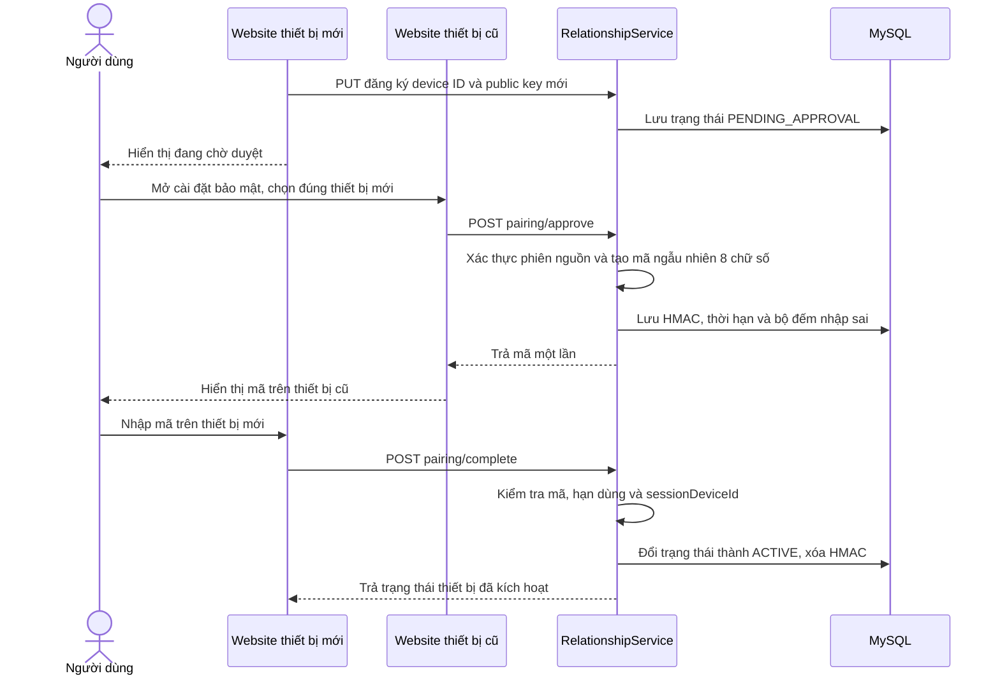

# Quy trình mã hóa đầu cuối (E2EE)

Tài liệu này mô tả phần E2EE hiện được áp dụng trong website VinaSocial: tạo khóa theo thiết bị, mã hóa tin nhắn và tệp ở client, ghép nối thiết bị mới, chuyển khóa giải mã lịch sử, thu hồi thiết bị, các API và dữ liệu server lưu.

Khi E2EE bật, website dùng Web Crypto với AES-GCM và RSA-OAEP. RelationshipService lưu ciphertext cùng các AES key wrapper đã được mã hóa cho thiết bị; server không nhận private key và không thể giải mã những tin E2EE đó. Khi người dùng tắt E2EE, server nhận nội dung rõ. Tài liệu này nói về nội dung tin nhắn và tệp; gọi thoại/video có phần tín hiệu được gửi như tin nhắn, còn luồng media do WebRTC xử lý riêng. Đây là prototype phục vụ đồ án, chưa phải giao thức nhắn tin được kiểm định độc lập.

**Chế độ mã hóa theo tài khoản:** Mặc định E2EE bật. Người dùng có thể tắt/bật trong **Cài đặt tài khoản → Bảo mật tài khoản → Mã hóa đầu cuối tin nhắn**; lựa chọn lưu tại RelationshipService và áp dụng trên mọi thiết bị. Mỗi lần gửi, website đọc thiết lập hiện tại và RelationshipService kiểm tra chế độ của người gửi trước khi lưu. Khi tắt, văn bản, sticker, liên kết chia sẻ và tệp/ảnh mới được gửi dạng rõ; server và Cloudinary có thể đọc chúng. Tin cũ giữ nguyên trạng thái lúc gửi. Tắt E2EE không tự thu hồi device key đã đăng ký. Bật lại E2EE yêu cầu mở khóa hoặc tạo kho khóa trên thiết bị trước khi gửi tin mã hóa.

## Thành phần

| Thành phần | Vai trò |
|---|---|
| Website (Next.js) | Tạo và lưu khóa riêng theo trình duyệt, đăng ký public key, mã hóa/giải mã nội dung tin nhắn và tệp đính kèm. |
| UserService | Gắn `e2ee_device_id` vào phiên đăng nhập hiện tại để trang bảo mật liên hệ phiên đăng nhập với thiết bị E2EE. Không lưu private key. |
| RelationshipService | Lưu thiết lập mã hóa theo tài khoản, quản lý public key thiết bị, ghép nối và thu hồi. Khi E2EE bật, lưu ciphertext và các wrapper AES key; khi tắt, lưu nội dung rõ. |
| MediaService | Khi E2EE bật, lưu tệp ciphertext opaque và không giữ AES key/IV; khi tắt, lưu tệp gốc. |
| IndexedDB | Lưu private key thiết bị đã được mã hóa bằng mật khẩu mở kho, hoặc giữ bản ghi `CryptoKey` legacy từ các phiên bản trước; đồng thời lưu các public key đã thấy trên trình duyệt. |
| Cloudinary | Lưu bytes tệp đã mã hóa hoặc tệp gốc theo chế độ gửi. |

## Thuật toán và định dạng

### Khóa thiết bị

- Mỗi tài khoản trên một browser profile có một cặp RSA-OAEP 3072-bit, public exponent 65537, SHA-256.
- Với thiết bị mới, RSA keypair tạm được tạo extractable trong bộ nhớ để export private key PKCS#8 một lần. Client dẫn xuất khóa 256-bit từ mật khẩu mở kho bằng Argon2id (19 MiB, 2 vòng, parallelism 1), mã hóa PKCS#8 bằng AES-256-GCM với salt 16 byte, IV 12 byte và AAD gắn với user ID, device ID và public JWK. Sau đó client import private key trở lại dưới dạng non-extractable và chỉ lưu bản mã, salt, IV, tham số KDF, public JWK và metadata thiết bị vào IndexedDB `vinasocial-e2ee`, object store `device-keys` với `userId` làm khóa chính.
- Mật khẩu mở kho không được gửi lên server hoặc lưu vào IndexedDB. Argon2id output và PKCS#8 rõ chỉ tồn tại tạm trong bộ nhớ trong lúc tạo/mở kho; khóa RSA non-extractable sau khi import được giữ trong bộ nhớ của tab khi đã mở khóa. Đăng xuất hoặc đổi tài khoản khóa bản trong bộ nhớ; tải lại/đóng tab cũng cần nhập lại mật khẩu.
- `hash-wasm` chạy Argon2id trong client. Salt và tham số KDF không phải bí mật; AES-GCM xác thực cả dữ liệu private key lẫn AAD. Sai mật khẩu hoặc dữ liệu bị sửa sẽ không import được private key.
- Các bản ghi `CryptoKey` cũ vẫn được đọc để không làm mất khả năng giải mã hiện có, nhưng không được tự chuyển thành dạng bảo vệ bằng mật khẩu. Do khóa cũ đã non-extractable, không thể export để bọc lại. Muốn nâng cấp mà giữ lịch sử cần tạo khóa mới trên browser profile mới, ghép nối từ thiết bị cũ, chuyển các AES message key wrapper, xác minh giải mã rồi mới thu hồi thiết bị cũ.
- Public key được export ở dạng JSON Web Key (JWK) và đăng ký với RelationshipService. Mỗi thiết bị có `deviceId` UUID riêng và tên thiết bị để hiển thị trong trang bảo mật.
- Thiết bị E2EE đầu tiên của tài khoản được kích hoạt ngay. Một khóa mới đăng ký khi đã có thiết bị đang hoạt động được giữ ở trạng thái `PENDING_APPROVAL` và không được trả về trong danh sách public key dùng để mã hóa tin mới.
- Việc tạo khóa dùng thao tác IndexedDB `add`, không ghi đè nếu một tab khác vừa tạo khóa cho cùng tài khoản. Các tab cùng browser profile dùng chung một device key trong IndexedDB, nhưng mỗi tab phải mở kho riêng vì khóa runtime chỉ nằm trong bộ nhớ của tab đó.
- Public key đã đăng ký không được đổi dưới cùng `deviceId`. Muốn thay khóa phải thu hồi thiết bị cũ và tạo device ID/khóa mới.
- Khi đăng xuất rồi đăng nhập lại tạo phiên mới trên cùng browser profile, client mở vault hiện có và yêu cầu server phát thử thách RSA-OAEP cho public key đã đăng ký. Client dùng private key cục bộ giải thử thách rồi gửi đáp án một lần để gắn device key với phiên mới. Server chỉ lưu HMAC của đáp án, ràng buộc với tài khoản, device ID và phiên mới; thử thách hết hạn sau 3 phút. Không cần tạo keypair mới hoặc chuyển lịch sử trong trường hợp này.

### Mật khẩu mở kho E2EE

- Khi E2EE đang bật và tài khoản chưa có khóa cục bộ trong browser profile, website yêu cầu đặt và xác nhận mật khẩu mở kho riêng, tối thiểu 8 ký tự, gồm chữ in hoa, chữ thường, chữ số và ký tự đặc biệt. Khi đã có bản ghi được bảo vệ, website yêu cầu nhập mật khẩu để mở khóa sau khi khôi phục phiên đăng nhập. Chính sách này chỉ áp dụng khi tạo kho mới, không chặn mở kho đã tạo trước đó.
- Mật khẩu không phải mật khẩu tài khoản và không gửi lên server. Ứng dụng không lưu mật khẩu, hash mật khẩu hoặc khóa Argon2id dẫn xuất trong IndexedDB. Salt và cấu hình Argon2id được lưu cùng ciphertext vì chúng không phải bí mật.
- Argon2id là hàm dẫn xuất khóa, không tự mã hóa private key. Output 32 byte được import tạm làm khóa AES-GCM không extractable; AES-GCM mã hóa private key PKCS#8. AES-GCM cũng xác thực AAD gồm ngữ cảnh, user ID, device ID và public JWK.
- Khi mở kho, ứng dụng giải mã PKCS#8 trong bộ nhớ rồi import private key với `extractable=false` và usage `decrypt`. Khóa runtime ở bộ nhớ đến khi đăng xuất/đổi tài khoản hoặc tab bị đóng/tải lại. Hiện chưa có timeout không hoạt động hay nút khóa thủ công; tab còn mở và đang đăng nhập sẽ giữ khóa runtime. Đăng xuất không xóa bản mã trong IndexedDB.
- Cấu hình Argon2id hiện được cố định ở 19 MiB, 2 vòng, parallelism 1 và output 32 byte. Client từ chối tham số lưu trong IndexedDB nếu chúng khác cấu hình hỗ trợ, tránh xử lý bản ghi với tham số tùy ý.
- Lớp bảo vệ này chỉ mã hóa private key khi lưu. Nó không thay thế AES-GCM/RSA-OAEP dùng để mã hóa tin nhắn.
- Trang **Cài đặt tài khoản → Bảo mật tài khoản → Mã hóa đầu cuối tin nhắn → Thiết bị nhắn tin được mã hóa đầu cuối** hiển thị khóa cục bộ đang ở dạng `PROTECTED` hoặc `LEGACY_UNPROTECTED`. Với legacy, website tiếp tục dùng khóa để giữ tương thích và báo hướng dẫn di chuyển; nó không âm thầm thay thế khóa.
- Nâng cấp legacy mà giữ lịch sử cần thiết bị/browser profile mới: đặt mật khẩu để tạo keypair được bảo vệ, ghép nối public key mới bằng thiết bị cũ, chuyển wrapper lịch sử, xác nhận mở được tin cũ rồi mới thu hồi thiết bị legacy. Việc thu hồi không xóa bản `CryptoKey` legacy trong IndexedDB cũ; chỉ xóa dữ liệu cục bộ ở profile cũ sau khi đã xác nhận thiết bị mới giải mã được lịch sử.
- Hiện chưa có chức năng đổi hoặc đặt lại mật khẩu mở kho. Đổi mật khẩu cần mở private key bằng mật khẩu cũ rồi mã hóa lại cùng keypair bằng salt/khóa dẫn xuất mới; quên mật khẩu thì cần một thiết bị khác còn mở được khóa nguồn để chuyển lịch sử.

### Envelope tin nhắn

Website serialize payload thành JSON, tạo AES-256 key mới cho từng tin nhắn, rồi mã hóa payload bằng AES-256-GCM. Mỗi lần mã hóa dùng IV ngẫu nhiên 12 byte, tag xác thực 128 bit và `clientMessageId` làm additional authenticated data (AAD):

```text
vinasocial:e2ee:v1:<clientMessageId>
```

AES key được export trong bộ nhớ để bọc riêng cho từng public key thiết bị đang hoạt động của các người nhận và các thiết bị của chính người gửi. Mỗi bản AES key được bọc bằng RSA-OAEP/SHA-256. Raw AES key không được lưu vào cơ sở dữ liệu.

Backend nhận JSON envelope theo định dạng:

```json
{
  "version": 1,
  "algorithm": "AES-256-GCM+RSA-OAEP-256",
  "iv": "<base64 IV>",
  "ciphertext": "<base64 AES-GCM ciphertext và tag>",
  "keys": {
    "<device UUID>": "<base64 AES key được RSA-OAEP bọc>"
  }
}
```

Envelope chứa một entry `keys` cho mỗi device public key đã lấy được khi gửi. Backend kiểm tra version, algorithm, Base64, IV dài 12 byte, ciphertext AES-GCM có ít nhất tag 16 byte, device ID dạng UUID, RSA ciphertext dài 384 byte và giới hạn tối đa 256 device key trong một envelope. Việc kiểm tra cấu trúc này không thay cho giải mã hoặc xác minh nội dung plaintext.

Payload được mã hóa có một trong các dạng:

- Văn bản/sticker: `{ "type": "TEXT" | "STICKER", "content": "..." }`.
- Tệp: `{ "type": "IMAGE" | "VIDEO" | "AUDIO" | "FILE", "media": { "objectKey", "key", "iv", "contentType", "fileName" } }`.

Ứng dụng kiểm tra cấu trúc payload sau khi giải mã trước khi hiển thị.

## Luồng đăng ký khóa thiết bị

```mermaid
sequenceDiagram
    actor U as Người dùng
    participant W as Website
    participant IDB as IndexedDB
    participant A as UserService
    participant R as RelationshipService
    participant D as MySQL

    U->>W: Đăng nhập hoặc khôi phục phiên
    W->>IDB: Đọc trạng thái khóa theo userId
    alt Chưa có khóa cục bộ
        W-->>U: Yêu cầu đặt mật khẩu mở kho E2EE
        U->>W: Nhập mật khẩu và xác nhận
        W->>W: Sinh RSA keypair, export PKCS#8 tạm thời
        W->>W: Argon2id dẫn xuất khóa AES; AES-GCM mã hóa PKCS#8
        W->>IDB: Lưu ciphertext, salt, IV, tham số, public JWK và metadata
        W->>W: Import private key runtime với extractable=false
    else Bản ghi được bảo vệ
        W-->>U: Yêu cầu mật khẩu mở kho
        U->>W: Nhập mật khẩu
        W->>W: Argon2id + AES-GCM mở PKCS#8, import non-extractable
    else Bản ghi legacy
        W->>IDB: Đọc CryptoKey non-extractable hiện có
        W-->>U: Thông báo khóa cũ chưa có lớp bảo vệ bằng mật khẩu
    end
    W->>R: PUT /api/v1/conversations/e2ee/keys/me
    alt Phiên hiện tại chưa gắn với phiên khác
        R->>D: Đăng ký/cập nhật tên và public key thiết bị
        R-->>W: deviceId và trạng thái khóa
    else Key đã gắn với phiên đăng nhập khác (409)
        W->>R: POST /{deviceId}/rebind/challenge
        R->>D: Lưu HMAC câu trả lời, phiên đích và hạn 3 phút
        R-->>W: Challenge đã mã hóa RSA-OAEP
        W->>W: Private key cục bộ giải challenge
        W->>R: POST /{deviceId}/rebind/complete với câu trả lời
        R->>D: Kiểm tra HMAC rồi gắn key với phiên hiện tại
        R-->>W: Trạng thái khóa đã gắn lại
    end
    W->>A: PUT /api/v1/auth/sessions/me/e2ee-device
    A->>D: Gắn deviceId vào phiên đăng nhập hiện tại
```

Website thực hiện việc này tự động khi phiên đã được khôi phục, tài khoản là `MEMBER` và E2EE đang bật. Nếu tạo/đồng bộ khóa lỗi, giao diện hiển thị thông báo. Khi một trình duyệt mới đăng ký sau khi tài khoản đã có thiết bị đang hoạt động, thiết bị mới được ghi nhận ở `PENDING_APPROVAL`; yêu cầu chờ duyệt có thời hạn 10 phút. Nếu hết hạn, lần đăng ký lại từ thiết bị đó mở lại thời hạn chờ duyệt. Public key chỉ được phân phối để nhận tin mới sau khi thiết bị được ghép nối.

Nếu key đã gắn với một phiên đăng nhập khác, lần đăng ký trả `409`. Website dùng private key cục bộ giải một challenge RSA-OAEP rồi gửi câu trả lời lên server để gắn lại key với phiên hiện tại. Challenge hết hạn sau 3 phút và server chỉ lưu HMAC của câu trả lời.

## Ghép nối thiết bị mới

Thiết bị mới tự tạo keypair RSA và `deviceId` mới trong browser profile đó. RelationshipService giữ public key ở trạng thái chờ duyệt. Phiên đăng nhập của thiết bị mới không thể tự duyệt yêu cầu của chính nó.

Một phiên đã được liên kết với một device key E2EE đang hoạt động có thể duyệt yêu cầu. Server sinh mã ghép nối ngẫu nhiên 8 chữ số, gắn mã với user ID và `deviceId` mới, chỉ trả mã trong response của thao tác duyệt và chỉ lưu HMAC của mã. Sau khi duyệt, mã hết hạn sau 3 phút, dùng một lần và tối đa 5 lần nhập sai; sau khi hết số lần thử, thiết bị cũ phải duyệt lại để cấp mã mới. Việc xác thực approver dùng `sessionDeviceId` trong JWT và trường `auth_session_device_id` được gắn với device key khi đăng ký.

Người dùng nhập mã trên thiết bị mới. Khi mã hợp lệ, RelationshipService chuyển trạng thái key thành `ACTIVE`; từ đó các lần gửi mới có thể bọc AES key cho public key của thiết bị mới. Trạng thái yêu cầu và mã không được dùng làm khóa mã hóa tin nhắn.

Các trạng thái key trong RelationshipService:

| Trạng thái | Ý nghĩa |
|---|---|
| `PENDING_APPROVAL` | Public key mới đã đăng ký nhưng chưa được một thiết bị đang hoạt động duyệt; chưa được công bố cho người gửi. |
| `CODE_ISSUED` | Thiết bị cũ đã duyệt đúng device ID và cấp mã; thiết bị mới phải nhập mã trước khi hết hạn. |
| `ACTIVE` | Thiết bị được dùng để nhận AES key cho tin nhắn mới và có thể nhận wrapper khi chuyển lịch sử. |
| `REVOKED` | Khóa đã bị thu hồi; không được dùng để mã hóa tin mới. Device ID đã thu hồi không được đăng ký lại với public key khác. |



Ghép nối chỉ xác nhận và kích hoạt public key của thiết bị mới. Thao tác này không gửi keypair cũ, không tự tạo wrapper lịch sử và không tự cấp dữ liệu plaintext cho thiết bị mới.

Ghép nối kích hoạt thiết bị mới nhưng không tự chuyển lịch sử. Sau đó người dùng có thể chọn **Chuyển lịch sử** trên một thiết bị E2EE đang hoạt động. Thiết bị nguồn tải lịch sử theo từng trang, chỉ mở AES key của envelope mà private key cục bộ (hoặc wrapper cũ đã nhận trước đó) giải mã được, rồi bọc AES key cho public key thiết bị đích. Client không gửi plaintext tin nhắn, AES key dạng rõ hoặc private key RSA lên server.

### Quy trình chuyển lịch sử

1. Trên trang bảo mật của thiết bị nguồn, người dùng chọn **Chuyển lịch sử** ở một thiết bị đích đang `ACTIVE` và xác nhận thao tác.
2. Client dùng private key RSA đang mở trong bộ nhớ của tab (đã mở từ vault hoặc là `CryptoKey` legacy), lấy public key của thiết bị đích và tải danh sách hội thoại đã chấp nhận cùng các yêu cầu nhắn tin đang chờ theo trang 50 bản ghi. Mỗi hội thoại chỉ được quét một lần.
3. Với mỗi tin E2EE chưa xóa, client tìm wrapper của thiết bị nguồn trong envelope hoặc trong wrapper bổ sung đã nhận. Client dùng RSA-OAEP giải bọc AES key rồi bọc lại AES key đó cho public key thiết bị đích. Client không cần giải mã payload tin nhắn để chuyển khóa.
4. Client gửi các wrapper theo lô 25 bản ghi lên endpoint lịch sử. API nhận tối đa 50 bản ghi mỗi request. Một item gồm `messageId`, `wrappedKey` Base64 và `ciphertextHash` SHA-256 dạng hex chữ thường.
5. Server xác thực phiên nguồn đang gắn với E2EE device active, thiết bị đích thuộc cùng tài khoản và còn active, quyền đọc hội thoại (kể cả người nhận yêu cầu nhắn tin đang chờ), envelope hợp lệ, khóa nguồn tồn tại và fingerprint khớp ciphertext hiện tại. Item có fingerprint lỗi thời bị bỏ qua; wrapper hiện hành được insert hoặc cập nhật theo cặp tin nhắn/thiết bị.
6. Khi thiết bị đích tải lịch sử, Message API đính kèm các wrapper hiện hành của E2EE device active cùng tài khoản. Client chọn wrapper có `deviceId` trùng với khóa cục bộ rồi giải mã bình thường.

```mermaid
sequenceDiagram
    actor U as Người dùng
    participant O as Website thiết bị nguồn
    participant IDB as IndexedDB nguồn
    participant R as RelationshipService
    participant DB as MySQL
    participant N as Website thiết bị mới

    U->>O: Chọn Chuyển lịch sử và xác nhận
    O->>R: GET danh sách thiết bị và public key đích
    O->>IDB: Đọc metadata khóa; dùng private CryptoKey đang mở trong bộ nhớ
    loop Mỗi trang message
        O->>R: GET ciphertext và wrapper đã có
        O->>O: RSA mở wrapper nguồn, RSA bọc AES key cho đích
        O->>R: POST lô history-wrappers + ciphertextHash
        R->>R: Kiểm tra phiên, quyền đọc và fingerprint
        R->>DB: Lưu wrapper theo messageId/deviceId
    end
    N->>R: GET lịch sử
    R->>DB: Đọc wrapper còn hiệu lực của tài khoản
    R-->>N: Ciphertext + wrapper của thiết bị active
    N->>N: Dùng private key cục bộ giải mã tin
```

Server lưu wrapper bổ sung riêng theo `messageId` và `deviceId`, gắn với SHA-256 của ciphertext hiện tại. Khi tin bị sửa và ciphertext đổi, wrapper cũ không được trả về cho client; một lần chuyển lịch sử sau đó có thể tạo wrapper khớp ciphertext mới. Unique key `(message_id, device_id)` giúp một thiết bị có tối đa một wrapper hiện hành cho mỗi tin; retry cùng ciphertext không tạo thêm hàng trùng. Message API chỉ trả wrapper của các thiết bị E2EE đang hoạt động cùng tài khoản và chỉ trả wrapper có fingerprint khớp ciphertext. File key nằm trong payload message đã mã hóa nên mở được AES key của message cũng mở được metadata/khóa file như hiện tại.

Việc chuyển có thể là một phần: tin nhắn đã xóa, không phải envelope E2EE hợp lệ, không có wrapper nguồn hoặc có ciphertext thay đổi giữa lúc tải và gửi sẽ không được thêm cho thiết bị đích. Nếu không còn thiết bị nào có khóa phù hợp, mã ghép nối và thao tác chuyển lịch sử không thể khôi phục các tin đó. Nếu mạng gián đoạn sau một số lô, các lô đã lưu vẫn có hiệu lực; chạy lại thao tác sẽ bỏ qua wrapper còn khớp và tiếp tục với phần còn lại.

Giao diện hiện báo tổng số tin đã quét và số wrapper server đã thêm. Giao diện chưa báo số tin bị bỏ qua theo từng nguyên nhân. Nếu wrapper nguồn tồn tại nhưng không giải bọc được bằng private key cục bộ, thao tác dừng với lỗi; các lô đã lưu trước lỗi vẫn còn trên server.

## Điều kiện chạy

- Website cần chạy trong secure context để dùng Web Crypto: HTTPS ở môi trường triển khai; `localhost` được trình duyệt xem là secure context khi phát triển.
- Trình duyệt phải hỗ trợ Web Crypto, IndexedDB và WebAssembly để chạy Argon2id. Structured clone của `CryptoKey` chỉ cần để đọc các bản ghi legacy.
- Mỗi tài khoản trong danh sách người nhận lúc gửi (bao gồm người gửi để đồng bộ trên thiết bị của mình) cần ít nhất một device public key đang hoạt động. Nếu thiếu, hàm mã hóa dừng trước khi gọi API gửi tin.
- Không có master key hay E2EE secret trong YAML/env của server. Private key được mở và dùng trong browser profile. Xóa IndexedDB làm mất bản mã cùng metadata cục bộ; muốn tiếp tục giải mã lịch sử cần thiết bị khác vẫn giữ key phù hợp hoặc đã được chuyển wrapper.

## Luồng gửi và nhận tin nhắn

```mermaid
sequenceDiagram
    actor S as Người gửi
    participant W1 as Website người gửi
    participant R as RelationshipService
    participant D as MySQL
    participant W2 as Website người nhận

    S->>W1: Soạn tin nhắn
    W1->>R: Lấy thành viên cuộc trò chuyện (nếu là nhóm)
    W1->>R: GET /api/v1/conversations/e2ee/keys?userIds=...
    R->>D: Đọc public key chưa bị thu hồi
    R-->>W1: Public key theo userId/deviceId
    W1->>W1: Kiểm tra TOFU và có khóa cho từng tài khoản
    W1->>W1: AES-GCM mã hóa payload; RSA-OAEP bọc AES key theo từng thiết bị
    W1->>R: Gửi clientMessageId, type và envelope ciphertext
    R->>D: Lưu messages.ciphertext và metadata tin nhắn
    R-->>W2: Trả ciphertext khi người nhận tải lịch sử
    W2->>W2: Tìm entry theo deviceId cục bộ
    W2->>W2: RSA giải bọc AES key, AES-GCM xác thực AAD và giải mã payload
    W2-->>S: Hiển thị nội dung sau giải mã
```

Khi gửi trong nhóm, website đọc danh sách thành viên hiện tại. Khi gửi tin trực tiếp mới, website dùng user ID hồ sơ người nhận. Danh sách user ID được chuẩn hóa và truy vấn public key; người gửi được thêm vào danh sách để có thể đọc tin đã gửi trên các thiết bị đang đăng ký của mình. Nếu bất kỳ tài khoản người nhận nào chưa có thiết bị E2EE hoạt động, website dừng gửi và báo lỗi.

Mỗi thiết bị chỉ giải mã được tin nhắn nếu envelope có entry đúng với `deviceId` cục bộ. Vì vậy, thiết bị mới không tự giải mã được lịch sử đã gửi trước khi public key của nó được đăng ký. Chỉnh sửa tin nhắn tạo ciphertext và AES key mới, vẫn dùng `clientMessageId` ban đầu làm AAD.

Các luồng gửi dùng chung thiết lập gồm chat chính, cửa sổ chat nổi, trả lời/chia sẻ từ story và chia sẻ bài viết. Cả khung chat chính và chat nổi đều cho chọn ảnh hoặc tệp bất kỳ. Khi bật E2EE, chúng dùng `encryptAttachment` trước upload. Khi tắt, chúng upload file gốc. Cột `messages.ciphertext` chứa envelope nếu bật và nội dung rõ hoặc URL tệp nếu tắt; trường `type` là `TEXT` cho envelope và loại thực tế cho tin rõ.

## Luồng mã hóa tệp đính kèm

1. Website tạo `clientMessageId`, một AES-256 key và IV ngẫu nhiên 12 byte.
2. Nội dung file được mã hóa AES-GCM với AAD:

   ```text
   vinasocial:e2ee:v1:<clientMessageId>:media
   ```

3. Website tải bytes ciphertext lên MediaService với `isEncrypt=true`, `isE2EE=true`, `purpose=MESSAGE`. Tên upload là UUID `.enc`, MIME type là `application/octet-stream`.
4. MediaService lưu object ciphertext, đánh dấu `encryption_mode=E2EE` và không lưu `encrypted_aes_key`/`encrypted_iv` phía server.
   Trước khi gọi Cloudinary, MediaService từ chối cờ mâu thuẫn hoặc yêu cầu mã hóa phía server chưa hỗ trợ. Chế độ tắt gửi `isEncrypt=false`, `isE2EE=false`, `purpose=MESSAGE` và lưu file gốc. API upload nhiều tệp kiểm tra chính sách của toàn bộ danh sách trước khi tải tệp đầu tiên.
5. Website đưa `objectKey`, AES key, IV, MIME type ban đầu và tên file vào payload tin nhắn rồi mã hóa toàn bộ payload theo luồng tin nhắn ở trên.
6. Khi đọc tin, website giải mã payload, tải object ciphertext từ `objectKey`, xác thực AAD và giải mã tệp. Tệp chỉ được tạo thành Blob URL trong trình duyệt.

Việc che giấu nội dung file không che giấu hoàn toàn metadata truyền tải: MediaService vẫn thấy người tải lên, thời điểm, kích thước gần đúng, mục đích `MESSAGE` và trạng thái E2EE.

## Gọi thoại và video

Gọi thoại/video hiện khả dụng trong cuộc trò chuyện cá nhân, không có trong nhóm. Offer, answer, SDP và tín hiệu kết thúc được gửi như nội dung tin nhắn; vì vậy khi thiết lập E2EE của người gửi đang bật, các tín hiệu này đi qua envelope tin nhắn ở trên. Khi người gửi tắt E2EE, chúng được gửi theo nhánh nội dung rõ. Âm thanh/video truyền trực tiếp qua `RTCPeerConnection` của trình duyệt, không qua mã hóa AES-GCM của envelope tin nhắn. Luồng media cuộc gọi không nằm trong phạm vi bảo vệ mà tài liệu này mô tả.

## API

Các route RelationshipService yêu cầu đăng nhập. Gateway local mặc định là cổng `8080`.

| Phương thức | Endpoint | Mục đích |
|---|---|---|
| `PUT` | `/api/v1/conversations/e2ee/keys/me` | Đăng ký public key và tên thiết bị của tài khoản hiện tại. Cùng device ID không được đổi key; khóa đã thu hồi không được kích hoạt lại. |
| `POST` | `/api/v1/conversations/e2ee/keys/me/{deviceId}/rebind/challenge` | Tạo challenge RSA-OAEP để chứng minh có private key cục bộ trước khi gắn key với phiên đăng nhập mới; hạn 3 phút. |
| `POST` | `/api/v1/conversations/e2ee/keys/me/{deviceId}/rebind/complete` | Gửi `answer` đã giải mã để hoàn tất gắn lại key với phiên hiện tại. |
| `POST` | `/api/v1/conversations/e2ee/keys/me/{deviceId}/pairing/approve` | Phiên được liên kết với một thiết bị E2EE đang hoạt động duyệt đúng device ID đang chờ; trả mã 8 chữ số một lần để hiển thị trên thiết bị duyệt. |
| `POST` | `/api/v1/conversations/e2ee/keys/me/{deviceId}/pairing/complete` | Thiết bị đang chờ nhập mã; mã đúng sẽ kích hoạt public key. |
| `POST` | `/api/v1/conversations/e2ee/keys/me/{deviceId}/history-wrappers` | Thiết bị nguồn đang hoạt động gửi tối đa 50 AES key wrapper đã bọc cho device đích cùng tài khoản; server xác minh quyền đọc tin và ciphertext hash trước khi lưu. |
| `GET` | `/api/v1/conversations/e2ee/keys/me` | Liệt kê thiết bị E2EE của tài khoản hiện tại, gồm cả thiết bị đã thu hồi để hiển thị lịch sử quản lý. |
| `GET` | `/api/v1/conversations/e2ee/keys?userIds=1,2` | Lấy public key của các thiết bị đang hoạt động của các user ID được yêu cầu; tối đa 50 user ID mỗi truy vấn. |
| `DELETE` | `/api/v1/conversations/e2ee/keys/me/{deviceId}` | Thu hồi public key thiết bị của tài khoản hiện tại. |
| `PUT` | `/api/v1/auth/sessions/me/e2ee-device` | UserService gắn E2EE device ID với phiên đăng nhập hiện tại. |
| `GET`, `PUT` | `/api/v1/conversations/me/encryption-setting` | Đọc/đổi chế độ mã hóa theo tài khoản; mặc định bật. |
| `GET` | `/api/v1/conversations/{conversationId}/participants` | Website lấy danh sách user ID để chọn public key cho tin nhóm/đoạn chat đã có; backend vẫn kiểm tra membership khi đọc danh sách. |
| `POST` | `/api/v1/users/{username}/messages` | Gửi tin nhắn trực tiếp hoặc message request; body mang `clientMessageId` và nội dung theo chế độ hiện tại. |
| `POST` | `/api/v1/conversations/{conversationId}/messages` | Gửi tin vào cuộc trò chuyện; server kiểm tra quyền tham gia và chế độ mã hóa của người gửi. |
| `GET` | `/api/v1/conversations/{conversationId}/messages` | Lấy lịch sử gồm tin mã hóa và tin rõ; website giải mã tin E2EE trên thiết bị. |
| `PATCH` | `/api/v1/conversations/{conversationId}/messages/{messageId}` | Sửa tin theo chế độ hiện tại; chỉ tác giả được sửa. |
| `POST` | `/api/v1/medias?isEncrypt=true&isE2EE=true` | Upload multipart bytes đã mã hóa; client đặt `purpose=MESSAGE`, `type=FILE`. |

Message create/edit API dùng trường `ciphertext` cho cả hai chế độ: envelope E2EE hoặc nội dung rõ. Message create yêu cầu `clientMessageId` UUID canonical dạng chữ thường; khi E2EE bật, đây là giá trị AAD nên phải giữ nguyên qua lưu trữ và giải mã.

## Lưu trữ và migration

- **IndexedDB phía website**: `vinasocial-e2ee` phiên bản 2; `device-keys` giữ ciphertext private key/metadata theo `userId` cho thiết bị mới và vẫn có thể giữ bản ghi `CryptoKey` legacy; `trusted-public-keys` giữ public key đã thấy theo `deviceId`.
- **RelationshipService / MySQL**: [V5__create_conversation_e2ee_device_keys.sql](../server/RelationshipService/src/main/resources/db/migration/V5__create_conversation_e2ee_device_keys.sql) tạo bảng `conversation_e2ee_device_keys`; [V6__add_e2ee_device_metadata.sql](../server/RelationshipService/src/main/resources/db/migration/V6__add_e2ee_device_metadata.sql) thêm tên thiết bị và `last_seen_at`; [V7__add_e2ee_device_pairing.sql](../server/RelationshipService/src/main/resources/db/migration/V7__add_e2ee_device_pairing.sql) thêm trạng thái đăng ký, phiên đăng nhập gắn khóa, HMAC mã ghép nối, hạn dùng và bộ đếm nhập sai; [V8__create_conversation_message_device_key_wrappers.sql](../server/RelationshipService/src/main/resources/db/migration/V8__create_conversation_message_device_key_wrappers.sql) lưu wrapper AES key bổ sung theo tin nhắn và thiết bị đích; [V9__message_encryption_settings.sql](../server/RelationshipService/src/main/resources/db/migration/V9__message_encryption_settings.sql) tạo thiết lập E2EE theo user với mặc định bật; [V10__add_e2ee_device_rebind_challenge.sql](../server/RelationshipService/src/main/resources/db/migration/V10__add_e2ee_device_rebind_challenge.sql) lưu HMAC, hạn dùng và phiên đích của thử thách gắn lại thiết bị.
- Bảng `conversation_message_device_key_wrappers` lưu `message_id`, `device_id`, `wrapped_key`, SHA-256 `ciphertext_hash` và `created_at`. Khóa ngoại tới `messages` và `conversation_e2ee_device_keys` dùng `ON DELETE CASCADE`; server không lưu raw AES key trong bảng này.
- **RelationshipService / messages**: bảng `messages` đã có `client_message_id` và `ciphertext` từ [V2__create_conversations_and_messages.sql](../server/RelationshipService/src/main/resources/db/migration/V2__create_conversations_and_messages.sql). Server cũng lưu sender, conversation, thời gian, trạng thái và loại request; các metadata này không được mã hóa.
- **UserService / MySQL**: [V3__add_device_auth_sessions.sql](../server/UserService/src/main/resources/db/migration/V3__add_device_auth_sessions.sql) thêm `e2ee_device_id` vào `auth_sessions` cùng metadata phiên.
- **MediaService / MongoDB và Cloudinary**: Media document ghi `encryption_mode=E2EE`, algorithm và object key; AES key và IV của tệp nằm trong payload message ciphertext, không nằm trong document.

Private key không được đồng bộ lên server. Xóa dữ liệu website/browser hoặc mất thiết bị sẽ làm mất bản mã cục bộ. Nếu quên mật khẩu mở kho, không thể mở private key đã mã hóa từ dữ liệu đó; không có backup/recovery key độc lập. Lịch sử có thể được chuyển từ thiết bị khác còn hoạt động sang một thiết bị mới đã ghép nối.

Chuyển wrapper lịch sử hiện chỉ cho phép chuyển giữa các thiết bị cùng tài khoản. Thành viên mới được thêm vào nhóm không nhận wrapper của các tin cũ; các tin mới có thể mã hóa cho thiết bị đang hoạt động của thành viên sau khi họ tham gia.

## Thu hồi thiết bị và thay khóa

Trang **Cài đặt tài khoản → Bảo mật tài khoản → Mã hóa đầu cuối tin nhắn → Thiết bị nhắn tin được mã hóa đầu cuối** hiển thị danh sách thiết bị. Thu hồi một device ID đặt `revoked_at`; public key đó không còn xuất hiện trong danh sách khóa dùng cho tin mới. Website đang liên kết phiên đăng nhập với device ID để thao tác thu hồi phiên có thể gọi thu hồi khóa tương ứng.

Thu hồi khóa và thu hồi phiên là hai API/service call riêng; giao diện báo riêng nếu phiên đã bị thu hồi nhưng khóa E2EE chưa thu hồi được. Thu hồi không xóa private key đã có trên thiết bị đó, không xóa ciphertext cũ và không ngăn thiết bị đã lấy được ciphertext cũ giải mã nó. Thu hồi phiên chặn refresh token; access token đã cấp có thể tiếp tục hoạt động đến khi hết hạn. Đăng xuất khóa private key khỏi bộ nhớ của ứng dụng nhưng không xóa bản mã trong IndexedDB.

Mã ghép nối hiện xác nhận một phiên đăng nhập đã liên kết với thiết bị E2EE đang hoạt động trong ứng dụng. Nó không phải chữ ký mật mã bằng private key của thiết bị cũ, không bảo vệ trước server bị chiếm quyền hoặc XSS đang chạy cùng origin, và không khôi phục lịch sử cũ. Mã chỉ là bước xác nhận giao dịch; không dùng mã làm khóa mã hóa.

## Mô hình bảo vệ và giới hạn

### Được bảo vệ

- Khi tài khoản bật E2EE, backend RelationshipService, database tin nhắn và object store nhận ciphertext của các tin và tệp được gửi bằng website hiện tại. Private key không được gửi lên server.
- AES-GCM phát hiện ciphertext, IV/AAD hoặc payload bị sửa; RSA-OAEP giúp chỉ thiết bị có private key tương ứng mới mở được AES key.
- Private key đang dùng sau khi mở kho được import với `extractable=false`; riêng lúc tạo khóa mới, private key được export PKCS#8 tạm thời trong bộ nhớ để mã hóa cục bộ rồi được import lại non-extractable. Public key không nhạy cảm và được server phân phối cho người gửi.
- Backend từ chối message create/edit không khớp chế độ mã hóa hiện tại của người gửi. Chế độ bật yêu cầu envelope đúng định dạng; chế độ tắt yêu cầu nội dung rõ.

### Không được bảo vệ hoặc chưa hoàn thiện

- Đây là thiết kế mã hóa hybrid tự xây ở mức prototype, không có forward secrecy, ratchet key hay post-compromise recovery. Thiết bị bị xâm nhập có thể ảnh hưởng các tin nhắn mà private key của nó mở được.
- Chưa có fingerprint/safety number để người dùng xác minh public key qua kênh khác. TOFU chỉ ghi nhớ key cục bộ theo device ID; thiết bị mới với ID mới được xem là key mới.
- Server kiểm tra envelope có cấu trúc hợp lệ nhưng chưa xác minh envelope thực sự chứa đủ public key của mọi thành viên và mọi thiết bị đang hoạt động trong conversation. API public key cũng chưa ràng buộc danh sách user ID với membership cuộc trò chuyện.
- MediaService không có khóa để tự xác minh bytes upload thật sự là ciphertext; client giả mạo có thể đặt hai cờ E2EE nhưng gửi bytes rõ. Tương tự, backend chỉ kiểm tra cấu trúc envelope, không đọc được payload để xác nhận metadata `objectKey` bên trong trỏ đến object ciphertext. Cam kết mã hóa áp dụng cho website hiện tại chạy đúng luồng client, không chống client đã bị sửa hoặc tài khoản chủ động gọi API tùy ý.
- Thu hồi thiết bị không thu hồi dữ liệu đã tải hoặc ciphertext cũ. Thu hồi phiên và thu hồi key không nguyên tử; bật 2FA cũng đánh dấu các phiên đăng nhập ở UserService đã thu hồi, nhưng access token hiện có có thể còn hiệu lực đến khi hết hạn và device key trong RelationshipService không tự bị thu hồi.
- Không che giấu metadata như thành viên cuộc trò chuyện, người gửi, thời điểm, trạng thái, kích thước ciphertext và thông tin upload cơ bản.
- Mã hóa đầu cuối không bảo vệ plaintext trên thiết bị đã mở khóa, khỏi XSS/mã độc/extension trình duyệt, hoặc khỏi người nhận sao chép nội dung.
- Tệp mã hóa đang giữ toàn bộ nội dung trong bộ nhớ trình duyệt khi mã hóa/giải mã, nên file lớn có thể tốn nhiều RAM.
- Tin nhắn cũ dạng plaintext (nếu có từ trước khi endpoint yêu cầu envelope) vẫn được client đọc theo nhánh tương thích cũ; nhánh này không phải E2EE.
- Khi tắt E2EE, nội dung tin và tệp mới không còn được bảo mật khỏi server, cơ sở dữ liệu hoặc người có URL tệp. Nếu kho khóa trên thiết bị vẫn khóa, tin E2EE cũ cần mở kho sau khi bật lại để đọc.

Nếu nâng cấp từ prototype đồ án lên hệ thống production, cần đánh giá protocol đã được kiểm định thay vì tiếp tục phát triển crypto tự xây: Signal PQXDH/Double Ratchet và Sesame cho one-to-one/multi-device, hoặc MLS cho nhóm. Đồng thời cần thiết kế xác minh thiết bị, recovery, đồng bộ nhóm và thu hồi key có kiểm chứng.

## Cách kiểm tra thủ công

1. Đăng nhập trên browser profile chưa có khóa E2EE. Đặt mật khẩu mở kho riêng tối thiểu 8 ký tự có chữ in hoa, chữ thường, chữ số và ký tự đặc biệt rồi xác nhận tạo khóa thiết bị. Kiểm tra từng trường hợp thiếu một điều kiện đều bị từ chối.
2. Kiểm tra IndexedDB `device-keys`: bản ghi mới có ciphertext private key, salt, IV, tham số Argon2id, public JWK và metadata; không có mật khẩu, raw Argon2 output hoặc private key `CryptoKey` lưu trực tiếp.
3. Tải lại trang. Xác nhận website hỏi mật khẩu mở kho; nhập sai thì vault không mở và tin E2EE không giải mã được, nhập đúng thì client import private key non-extractable và khôi phục giải mã.
4. Đăng xuất rồi đăng nhập lại trên cùng browser profile. Xác nhận client mở vault cũ, hoàn tất thử thách gắn lại phiên và tiếp tục đọc/gửi tin bằng cùng device ID; thử đáp án sai hoặc dùng lại đáp án phải bị từ chối.
5. Kiểm tra Network khi tạo/đăng ký thiết bị: request chỉ chứa device ID, device name và public JWK; không chứa mật khẩu, private key PKCS#8 hoặc khóa AES dẫn xuất.
6. Với profile đã có khóa legacy, xác nhận website hiển thị cảnh báo và vẫn giữ khóa cũ. Tạo thiết bị được bảo vệ trong profile mới, ghép nối, chuyển lịch sử, kiểm tra mở được tin cũ rồi mới thu hồi thiết bị legacy.
7. Đăng nhập hai tài khoản trên hai browser profile khác nhau; mở trang bảo mật và kiểm tra mỗi tài khoản có thiết bị E2EE đang hoạt động.
8. Đăng nhập cùng một tài khoản trên browser profile mới. Kiểm tra khóa mới hiện `Chờ duyệt`, chưa có trong API public key đang hoạt động và chưa gửi được tin E2EE. Trên thiết bị cũ, duyệt yêu cầu rồi nhập mã hiển thị ở đó vào thiết bị mới; xác nhận key chuyển thành `ACTIVE` và có thể nhận tin gửi sau ghép nối.
9. Trên thiết bị cũ chọn **Chuyển lịch sử** cho thiết bị mới. Kiểm tra số wrapper tiến độ, mở một tin cũ mà thiết bị nguồn đọc được trên thiết bị mới, và xác nhận tin không có wrapper nguồn sẽ vẫn không giải mã được. Kiểm tra thêm tin đầu tiên trong yêu cầu nhắn tin đang chờ.
10. Gửi văn bản, sticker, ảnh, video, ghi âm và file. Kiểm tra người nhận xem được nội dung sau khi client tải và giải mã.
11. Quan sát Network/Database: request message chứa envelope JSON; không thấy văn bản gốc hoặc AES key dạng rõ. File upload là bytes opaque, MIME type `application/octet-stream`; metadata message chứa phần giải mã đã được bọc trong envelope.
12. Thu hồi một thiết bị, gửi tin mới và xác nhận key registry không còn trả public key đó. Ciphertext cũ vẫn tồn tại; không dùng thu hồi như thao tác xóa lịch sử.
13. Thử đăng ký một device ID mới hoặc đổi public key dưới device ID cũ; khóa cũ không được thay thế âm thầm. Khi client gặp một key mới, giao diện hiện chưa có bước xác minh fingerprint ngoài TOFU.

Các bước trên là checklist thủ công; chúng không thay thế security review, kiểm thử đa trình duyệt, kiểm thử tranh chấp khi nhiều tab cùng đăng ký, hoặc kiểm tra khôi phục sau khi xóa browser storage.

## Cấu trúc code chính

- Crypto, IndexedDB, envelope và file encryption/decryption: [e2eeMessageUtil.ts](../client/website/src/utils/e2eeMessageUtil.ts).
- Giải mã lịch sử message: [useDecryptedMessages.ts](../client/website/src/hooks/useDecryptedMessages.ts).
- Chat thường, gửi văn bản và attachment: [MessagesComponent.tsx](../client/website/src/components/social/MessagesComponent.tsx); khung chọn attachment: [ChatInputComponent.tsx](../client/website/src/components/social/messages/main-content/ChatInputComponent.tsx); chat nổi, upload và sửa tin: [ChatDetailComponent.tsx](../client/website/src/components/social/floating-message/ChatDetailComponent.tsx).
- Chính sách từ chối upload media `MESSAGE` chưa mã hóa: [MediaServiceImplement.java](../server/MediaService/src/main/java/vn/tuhoc/MediaService/services/MediaServiceImplement.java), được kiểm tra tại [MediaServiceEncryptionPolicyTest.java](../server/MediaService/src/test/java/vn/tuhoc/MediaService/services/MediaServiceEncryptionPolicyTest.java).
- Gửi từ story: [MainComponent.tsx](../client/website/src/components/social/story/viewer/MainComponent.tsx); chia sẻ từ bài viết: [PostDetailDialogComponent.tsx](../client/website/src/components/social/feed/PostDetailDialogComponent.tsx).
- Tự đăng ký và gắn key với phiên: [AuthSessionProvider.tsx](../client/website/src/providers/AuthSessionProvider.tsx).
- Gọi thoại/video và gửi tín hiệu qua luồng tin nhắn: [useE2eeConversationCall.ts](../client/website/src/hooks/useE2eeConversationCall.ts), [MessagesComponent.tsx](../client/website/src/components/social/MessagesComponent.tsx).
- Màn hình thiết lập mã hóa, quản lý thiết bị và chuyển lịch sử: [MessageEncryptionComponent.tsx](../client/website/src/components/social/profile/edit/MessageEncryptionComponent.tsx).
- Thư viện Argon2id cho client: dependency `hash-wasm` trong [package.json](../client/website/package.json).
- Quản lý public key thiết bị: [ConversationE2eeDeviceKeyController.java](../server/RelationshipService/src/main/java/vn/tuhoc/RelationshipService/controllers/ConversationE2eeDeviceKeyController.java), [ConversationE2eeDeviceKeyService.java](../server/RelationshipService/src/main/java/vn/tuhoc/RelationshipService/services/ConversationE2eeDeviceKeyService.java).
- Chuyển lịch sử và fingerprint ciphertext: [E2eeMessageKeyWrapperService.java](../server/RelationshipService/src/main/java/vn/tuhoc/RelationshipService/services/E2eeMessageKeyWrapperService.java), [ConversationMessageDeviceKeyWrapperEntity.java](../server/RelationshipService/src/main/java/vn/tuhoc/RelationshipService/domains/entities/ConversationMessageDeviceKeyWrapperEntity.java), [E2eeCiphertextFingerprintUtil.java](../server/RelationshipService/src/main/java/vn/tuhoc/RelationshipService/utils/E2eeCiphertextFingerprintUtil.java).
- Kiểm tra định dạng envelope ở backend: [E2eeEnvelopeValidationUtil.java](../server/RelationshipService/src/main/java/vn/tuhoc/RelationshipService/utils/E2eeEnvelopeValidationUtil.java).
- Lưu attachment theo chế độ E2EE: [MediaServiceImplement.java](../server/MediaService/src/main/java/vn/tuhoc/MediaService/services/MediaServiceImplement.java).

