# Sequence nghiệp vụ chính

Các sơ đồ thể hiện thành phần và thứ tự xử lý ở mức service. Tên endpoint lấy từ controller hiện có; chi tiết payload nằm trong DTO tương ứng.

## Đăng nhập khi bật 2FA

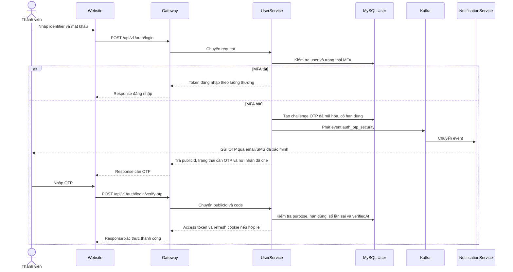

## Xem trang cá nhân và bài viết

```mermaid
sequenceDiagram
    actor V as Người xem
    participant W as Website
    participant G as Gateway
    participant US as UserService
    participant CS as ContentService
    participant R as RelationshipService
    V->>W: Mở /{username}
    W->>G: GET /api/v1/users/profile/{username}
    G->>US: Chuyển request cùng thông tin xác thực (nếu có)
    US->>US: So sánh người xem với chủ hồ sơ và áp dụng privacy
    US-->>G: ProfileDetail nếu chính chủ; dữ liệu public nếu người khác
    G-->>W: Response profile
    W->>G: GET /api/v1/posts/profile/{username}
    G->>CS: Chuyển request
    CS->>US: Lấy user/profile/quyền xem qua UserClient
    opt Quyết định quyền phụ thuộc quan hệ
        CS->>R: Lấy trạng thái follow/audience cần thiết
        R-->>CS: Trạng thái quan hệ
    end
    CS->>CS: Lọc status, moderation và privacy bài viết
    CS-->>G: Danh sách bài viết được phép xem
    G-->>W: Response bài viết
    W-->>V: Hiển thị hồ sơ và nội dung
```

## Cập nhật hồ sơ và ảnh đại diện

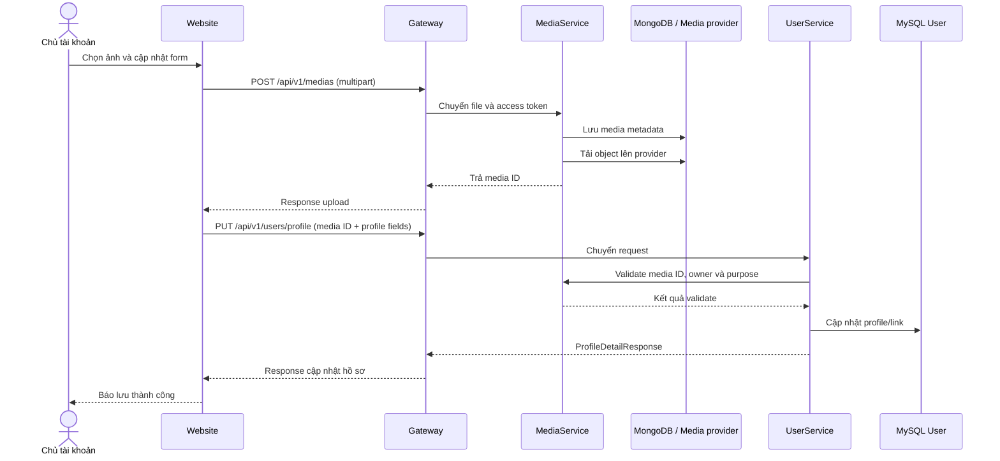

Thông tin cá nhân, privacy setting và notification setting dùng các endpoint/request riêng trong UserService; không gộp chúng vào request cập nhật profile.

## Follow tài khoản riêng tư

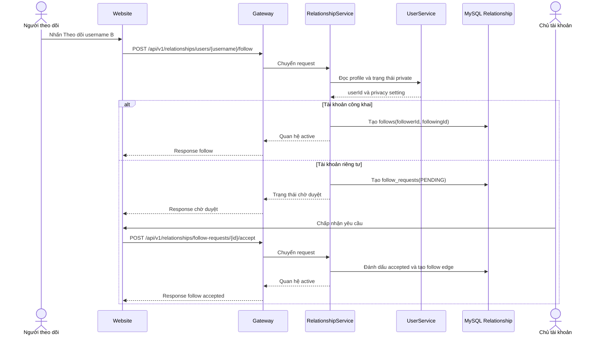

## Gửi tin nhắn lần đầu

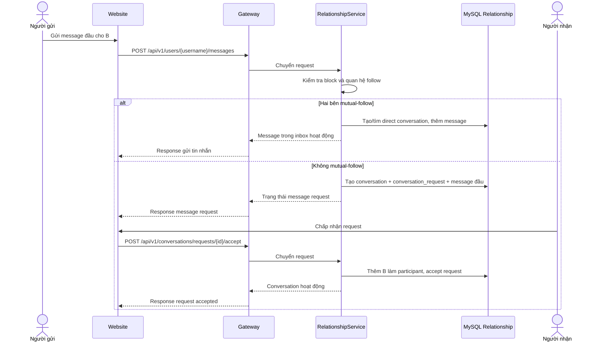

## Tạo bài viết có media

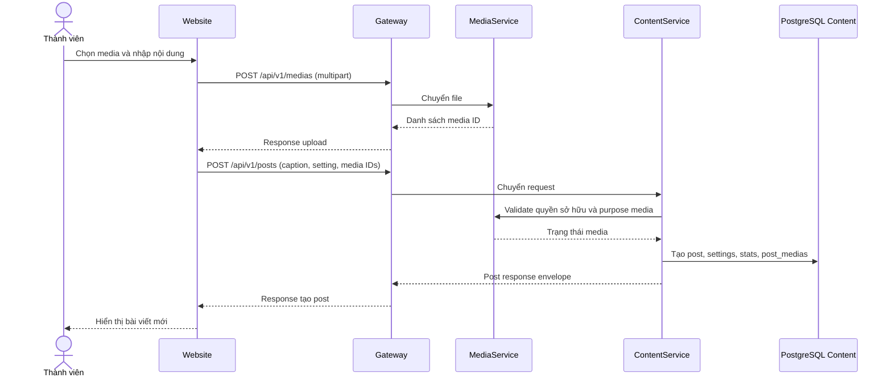

## Phát notification từ event

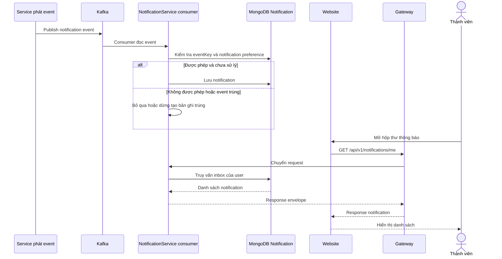

## Khôi phục mật khẩu bằng OTP

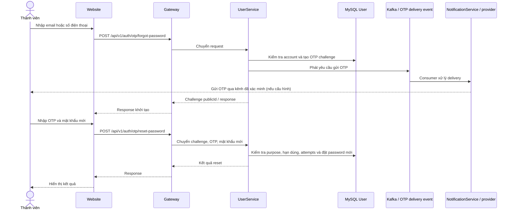

## Tương tác với bài viết và gửi báo cáo

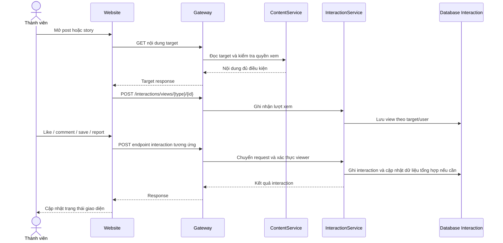

## Quản trị xử lý nội dung và report

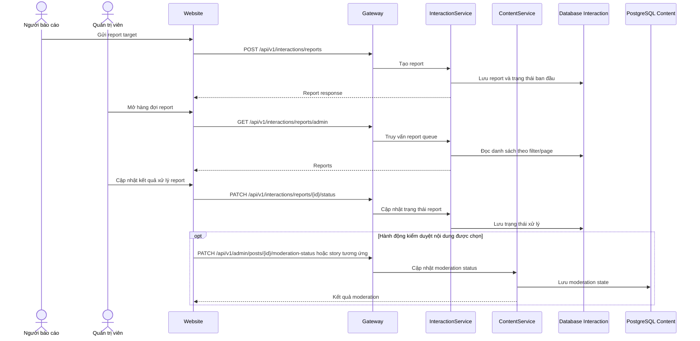

## Tạo group conversation, thêm thành viên và rời nhóm

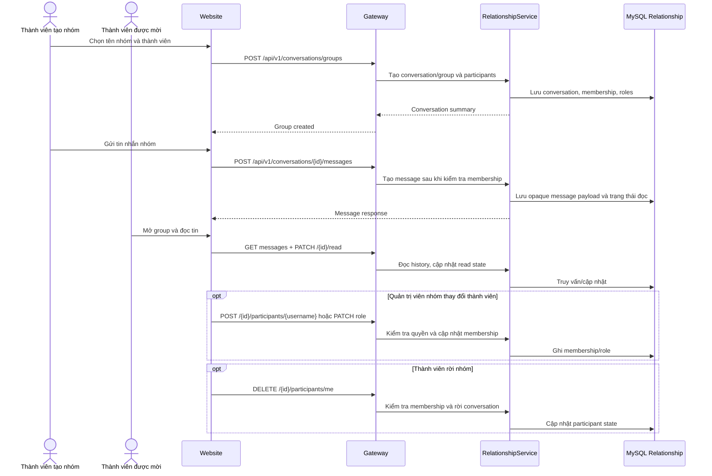

## Cập nhật một loại setting hồ sơ

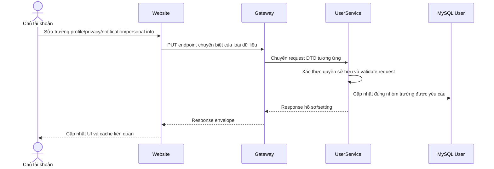

## Ghi chú về sơ đồ

- Đây là luồng khái niệm dựa trên controller, service, client và thiết kế hiện tại; tên bảng lưu đã được giản lược. Dùng database docs cho tên collection/table thực tế.
- Sơ đồ không thay thế authorization matrix. Điều kiện truy cập đầy đủ phải kiểm tra Security configuration và từng service method.
- Các mũi tên event/provider biểu diễn kiến trúc dự kiến/current integration; trạng thái gửi OTP, event phát sinh và preference filtering phụ thuộc config/producer thực tế.
- Website mã hóa payload trước khi gửi; RelationshipService chỉ lưu envelope ciphertext và server không giải mã. Key registry theo thiết bị đã có, nhưng prototype hiện chưa thiết lập khóa theo protocol có forward secrecy hoặc xác minh fingerprint; xem [RelationshipService design](../../server/RelationshipService/DESIGN.md).
