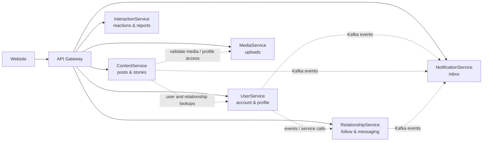

# Danh mục nghiệp vụ theo service

Tài liệu này trả lời ba câu hỏi cho từng service: service chịu trách nhiệm nghiệp vụ gì, website đang gọi phần nào, và phần nào chưa thể kết luận đã hoàn thiện. Danh sách API đầy đủ ở [API Reference](../API_REFERENCE.md); cấu trúc lưu trữ ở [Database docs](../database/README.md).

## Luồng tổng thể

Website gọi API qua Gateway. Mỗi domain service sở hữu dữ liệu nghiệp vụ của mình; các service trao đổi qua Feign/HTTP khi cần đọc đồng bộ và Kafka cho event bất đồng bộ. ID liên service được dùng để tham chiếu, không tạo foreign key xuyên database. Response envelope chuẩn là `RestResponseDTO<T>`, nhưng một vài endpoint/trường hợp tích hợp trả kiểu trực tiếp; client cần khớp contract cụ thể.

## UserService

**Nghiệp vụ:** đăng ký/đăng nhập, OTP và khôi phục mật khẩu, refresh/logout, MFA, dữ liệu tài khoản, xem hồ sơ theo viewer, cập nhật trang cá nhân/thông tin cá nhân và cài đặt privacy/notification.

**Quy tắc từ implementation:** hồ sơ được phân biệt chính chủ và người xem khác; contract có thể trả `ProfileDetailResponseDTO` hoặc `ProfilePublicResponseDTO`. Việc cập nhật trang cá nhân, thông tin cá nhân, privacy và notification dùng route/request riêng. `POST /users/info` là batch lookup theo nhiều ID và response là list trực tiếp theo controller.

**Website đang nối:** auth forms (register/login/OTP/forgot/reset), refresh token/logout, trang hồ sơ/edit, ProfileSettings, MFA Security, user admin, batch lookup tên/ảnh user trong các màn hình quan hệ, comments, groups và admin reports.

**Đọc tiếp:** [UserService DB](../database/USER_SERVICE.md), [2FA](../2FA-IMPLEMENTATION.md), [API Reference](../API_REFERENCE.md#userservice--xác-thực-hồ-sơ-tài-khoản).

## ContentService

**Nghiệp vụ:** tạo/sửa/đọc post, tạo/đọc/xóa story và cập nhật thiết lập story; truy vấn feed/profile; luồng quản trị trạng thái nội dung và trạng thái moderation.

**Quy tắc từ implementation:** post/story gắn media bằng ID được MediaService xác nhận. Khi trả nội dung, service áp dụng trạng thái nội dung, moderation, thời hạn story và quyền truy cập liên quan. Admin API tách `status` khỏi `moderation-status`.

**Website đang nối:** home feed, post detail, profile posts, create/edit post và reels, story feed/viewer/create, trang quản trị posts/stories/reels. Có trang thống kê UI; cần đối chiếu nguồn dữ liệu của từng biểu đồ trước khi xem đó là backend analytics đầy đủ.

**Phạm vi cần chú ý:** interaction counters/likes/comments được quản lý bởi InteractionService, không nên suy ra từ bảng post. Reels hiện dùng luồng post/media tương ứng; không thấy controller reel domain riêng trong danh sách controller.

**Đọc tiếp:** [ContentService DB](../database/CONTENT_SERVICE.md), [API Reference](../API_REFERENCE.md#contentservice--post-story-moderation).

## RelationshipService

**Nghiệp vụ:** follow/follow request, followers/following, relationship status, block, Close Friends, story audience; direct/group conversations, message requests, participants/roles, message read state, gửi/sửa/xóa tin.

**Quy tắc từ implementation/design:** tài khoản private có follow request; chấp nhận tạo/hoạt hóa quan hệ. Block ảnh hưởng các tương tác giữa hai người theo domain rules. Close Friends là danh sách do chủ tài khoản quản lý; story audience query tính IDs được phép xem theo visibility. Direct message đầu tiên có thể được đưa vào requests thay inbox hoạt động, tùy quan hệ/điều kiện. Mutations kiểm tra participant/author/role. Website đã mã hóa tin nhắn và tệp đính kèm phía client, với key registry theo thiết bị; đây là prototype chưa có forward secrecy và fingerprint verification. Xem [tài liệu triển khai E2EE](../E2EE-IMPLEMENTATION.md) và `server/RelationshipService/DESIGN.md` để biết luồng và giới hạn.

**Website đang nối:** profile follow/block actions, friends page (followers/following/requests/blocks), BestFriends editor, direct/group messages, floating chat, story audience/view interactions. Không phải mọi endpoint message request/role đều có UI đầy đủ.

**Đọc tiếp:** [RelationshipService DB](../database/RELATIONSHIP_SERVICE.md), [API Reference](../API_REFERENCE.md#relationshipservice--follow-block-conversations-messages).

## InteractionService

**Nghiệp vụ:** like và trạng thái like, comments/replies/edit/delete/status, view tracking/viewers, save, reup, share, report, target summary.

**Quy tắc từ implementation:** tương tác tham chiếu target qua loại và ID; dữ liệu target nằm ở ContentService nên không có FK database liên service. Mọi danh sách/filter/status phải dựa trên DTO và enum source. Báo cáo do người dùng gửi và quản trị xử lý cùng service; quyền admin cần Security config.

**Website đang nối:** post/story likes, comments/replies, view tracking cho post/story, save/reup, share dialog, report dialog, My Reports/Saved pages và admin reports. Liker/viewer lists, shares listing, comment moderation endpoints có thể chưa có màn hình tương ứng.

**Đọc tiếp:** [InteractionService DB](../database/INTERACTION_SERVICE.md), [API Reference](../API_REFERENCE.md#interactionservice--like-comment-view-save-share-report).

## MediaService

**Nghiệp vụ:** nhận file, kiểm tra media, lấy batch metadata và trả tham chiếu để các domain khác liên kết media. Metadata lưu riêng với object của storage provider.

**Website đang nối:** avatar/profile image, attachments trong post/reel và story. Upload từ các component hiện dùng service hook pattern; hãy xem component cụ thể khi mô tả loading/error/retry.

**Quy tắc:** validate ID/owner/purpose trước khi service khác sử dụng. Chi tiết provider, metadata/mã hóa và file constraints nằm trong implementation/config, không suy diễn từ endpoint.

**Đọc tiếp:** [MediaService DB](../database/MEDIA_SERVICE.md), [API Reference](../API_REFERENCE.md#mediaservice--apiv1medias).

## NotificationService

**Nghiệp vụ:** nhận notification events, tạo inbox items, phân trang/lọc unread, đếm unread, đánh dấu một/toàn bộ đã đọc và dismiss.

**Website đang nối:** header unread count và notification popover; các thao tác mark-as-read/read-all. Trạng thái preference được cập nhật bởi UserService, còn tiếp nhận/suppression event do NotificationService xử lý.

**Quy tắc:** idempotency và preference filtering phải căn cứ event consumer/database implementation; không giả định mọi hành động trong sản phẩm đã phát event chỉ vì consumer tồn tại.

**Đọc tiếp:** [NotificationService DB](../database/NOTIFICATION_SERVICE.md), [API Reference](../API_REFERENCE.md#notificationservice--apiv1notifications).

## Hệ thống nền tảng

Gateway định tuyến API và tổng hợp OpenAPI. ConfigService cung cấp cấu hình tập trung; Discovery/Eureka định vị service; Kafka vận chuyển event; observability/configuration hỗ trợ vận hành. Các thành phần này không phải domain use case của thành viên và không có database nghiệp vụ trong bộ tài liệu domain hiện tại. Mô tả topology ở [Architecture](../ARCHITECTURE.md) và cách chạy ở [Development](../DEVELOPMENT.md).

## Kiểm kê giao diện và khoảng trống

| Khu vực website | Nghiệp vụ đang thể hiện | Ghi chú phạm vi |
|---|---|---|
| Auth | Đăng ký, login, OTP, khôi phục password, MFA | Kiểm tra route/form tương ứng trước khi kết luận mọi nhánh lỗi đã có UX. |
| Profile | Xem hồ sơ, follow actions, sửa profile, privacy/notification/security, Close Friends | Các tab repost/tagged/highlights không có API riêng đã xác nhận; Best Friends là UI Close Friends chứ không tự đồng nghĩa khái niệm khác. |
| Feed/content | Feed, post detail, create/edit posts, stories, reels | Reels dùng post/media flow; phân biệt feature UI với domain controller. |
| Social graph | Followers/following/requests/blocks | Giao diện danh sách gọi API RelationshipService và batch lookup UserService. |
| Messaging | Inbox/chat/group, đọc/gửi/sửa/xóa, tạo group | Cần kiểm tra request inbox, accept/reject, participant roles nếu muốn xác nhận UI coverage; API có nhưng không thấy mọi luồng được nối. |
| Interactions | Likes, comments/replies, saves, reups, shares, reports, views | Có một số endpoint chỉ phục vụ admin/analytics hoặc chưa thấy màn hình gọi. |
| Admin | User admin, post/story moderation, report processing, statistics pages | Các trang thống kê tồn tại; nguồn số liệu backend và quyền truy cập cần đọc riêng. |
| Database | Sáu domain databases | Sơ đồ service/database chi tiết ở `docs/database/`; không gộp shared DB giữa services. |

Không thấy một controller/API riêng trong source được ghi là “chưa có endpoint riêng”, thay vì ghi nhận là chưa triển khai tuyệt đối. UI mock/placeholder cần đánh dấu theo component cụ thể.
