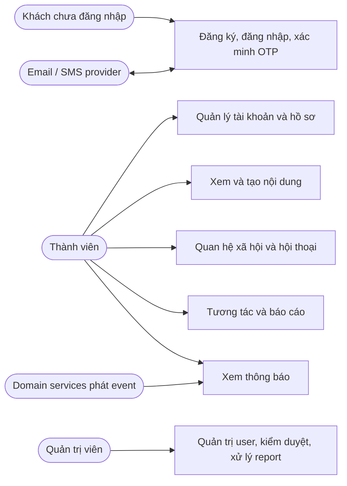

# Use case VinaSocial

Phạm vi use case được đối chiếu với route controller backend và các màn hình/API service website hiện có. “Có API” chỉ có nghĩa route tồn tại; “website đang nối” được ghi nhận khi thấy client/component gọi API.

## Tác nhân

## Use case theo tác nhân

### Khách và chủ tài khoản

| ID | Use case | Kết quả/điều kiện chính | Backend | Website |
|---|---|---|---|---|
| A01 | Đăng ký | Tạo tài khoản hợp lệ; có thể đi kèm xác minh OTP theo flow hiện hành. | UserService auth | Có form đăng ký. |
| A02 | Đăng nhập | Xác thực credential; MFA bật thì hoàn tất OTP challenge trước khi nhận phiên. | UserService auth + NotificationService delivery path | Có login và OTP UI. |
| A03 | Refresh và logout | Duy trì/thu hồi phiên theo token strategy. | UserService auth | Có session provider/logout. |
| A04 | Khôi phục mật khẩu | Gửi OTP, xác minh challenge và đặt mật khẩu mới. | UserService AuthOtp | Có forgot/reset/verify screens. |
| A05 | Bật/tắt MFA | Xem trạng thái, khởi tạo thao tác, xác minh để hoàn tất. | UserService MFA | Có Security component. |
| A06 | Xem hồ sơ bản thân/ người khác | Trả profile detail cho chính chủ; public profile cho viewer khác, theo privacy/authorization. | UserService profile | Có trang `/{username}`. |
| A07 | Sửa profile | Sửa profile fields và ảnh; upload media riêng rồi lưu media reference. | MediaService + UserService | Có Profile Settings. |
| A08 | Sửa thông tin cá nhân | Cập nhật trường riêng tư qua request chuyên biệt. | UserService | Có Profile Settings. |
| A09 | Cài privacy và notifications | Gửi request theo loại setting riêng; không dùng response DTO làm request update. | UserService | Có Profile Settings. |
| A10 | Tạo bài viết/reel | Upload media, gửi content và cấu hình tạo post; reel dùng post/media flow trong client. | MediaService + ContentService | Có composer/reel dialog. |
| A11 | Đọc feed và post detail | Truy vấn feed/chi tiết, tải nội dung đủ quyền. | ContentService + User/Relationship lookup | Có home/feed/detail. |
| A12 | Sửa post | Chủ nội dung cập nhật post theo quyền sở hữu. | ContentService | Có edit flow trong composer khi mở post hiện hữu. |
| A13 | Tạo/xem/xóa story | Upload media, chọn audience/settings, xem feed hoặc story của mình/user, xóa story. | MediaService + ContentService + RelationshipService + InteractionService views | Có story create/feed/viewer. |
| A14 | Follow/unfollow | Public account tạo quan hệ; private account có thể cần request; hủy quan hệ/request. | RelationshipService | Có action trên profile. |
| A15 | Quản lý follow requests | Xem request đến; accept, reject hoặc hủy request đã gửi. | RelationshipService | Có friends page cho requests đến. |
| A16 | Quản lý followers/following | Xem danh sách và mở profile/thao tác tương ứng. | RelationshipService + UserService batch info | Có friends page. |
| A17 | Quản lý Close Friends | Thêm/xóa/xem danh sách; dùng audience story phù hợp. | RelationshipService | Có BestFriends component kết nối Close Friends API. |
| A18 | Block/unblock | Chặn hoặc bỏ chặn user; xem danh sách đã chặn. | RelationshipService | Có profile actions/friends page. |
| A19 | Gửi tin trực tiếp | Tạo hoặc tìm direct conversation; nếu chưa đủ điều kiện thì thành request. | RelationshipService | Có message UI, nhưng coverage request flows cần xác nhận từng trạng thái. |
| A20 | Nhắn tin nhóm | Tạo group; quản lý thành viên/role; rời nhóm. | RelationshipService | Có trang groups và floating message; không đồng nghĩa mọi thao tác role/leave đều có UI. |
| A21 | Quản lý tin nhắn | Đọc lịch sử, đánh dấu đã đọc, gửi/sửa/xóa tin theo quyền. | RelationshipService | Có chat components. |
| A22 | Like/comment/reply | Tạo/gỡ like, viết/sửa/xóa comment, mở reply; có thể truy vấn summary. | InteractionService | Có post/story likes và comments. |
| A23 | Save/reup/share | Lưu/gỡ lưu, đăng lại/gỡ, chia sẻ target. | InteractionService | Có Saved, Profile reposts, share dialogs. |
| A24 | Báo cáo | Gửi report và xem danh sách báo cáo của mình. | InteractionService | Có dialog và My Reports. |
| A25 | Xem notification | Xem danh sách/unread count, đọc một/toàn bộ, dismiss item. | NotificationService | Có header notification popover. |
| A26 | Tìm kiếm | Tra cứu nội dung/user theo khả năng search hiện có. | Cần kiểm tra service/search implementation cụ thể; controller inventory chưa cho thấy domain search riêng. | Có search page; không khẳng định đã tích hợp backend đầy đủ. |

### Quản trị viên

| ID | Use case | Kết quả | Backend | Website |
|---|---|---|---|---|
| M01 | Tra cứu/quản trị user | Xem danh sách/chi tiết, tạo, cập nhật, đổi trạng thái, xóa theo quyền admin. | UserService | Có admin users page. |
| M02 | Kiểm duyệt post | Tra cứu nội dung, đổi status và moderation status độc lập. | ContentService AdminPostController | Có admin posts page. |
| M03 | Kiểm duyệt story | Tra cứu story, đổi status và moderation status. | ContentService AdminStoryController | Có admin stories/reels views. |
| M04 | Xử lý report | Xem report admin queue và cập nhật trạng thái xử lý. | InteractionService ReportController | Có admin reports page. |
| M05 | Xem thống kê | Hiển thị thống kê user/content/moderation. | Cần đối chiếu endpoint/data provider của từng page; controller list hiện không chỉ ra analytics controller riêng. | Có statistics pages. |

### Tác nhân hệ thống

| ID | Use case | Quy tắc/đầu ra |
|---|---|---|
| S01 | Gửi OTP và thông báo | Auth/domain event được chuyển qua event/notification path; gửi email/SMS phụ thuộc provider cấu hình. |
| S02 | Tạo notification từ event | Consume event, áp dụng preference/idempotency nếu implementation hỗ trợ, lưu inbox item. Không suy ra event nào đã được phát nếu chưa kiểm tra producer. |
| S03 | Xác thực media liên service | Domain service xác nhận owner/purpose/media IDs trước khi gắn vào nội dung/profile. |
| S04 | Kiểm tra audience story | Trả tập user/owner IDs viewer hiện tại được xem theo visibility. Route hiện là POST query với danh sách IDs, không phải endpoint ghi setting. |
| S05 | Service discovery và cấu hình | Gateway định tuyến, Discovery tìm service, ConfigService cung cấp cấu hình; đây là use case nền tảng/vận hành. |

## Quy tắc nghiệp vụ xuyên suốt

1. Một service sở hữu và thay đổi dữ liệu nghiệp vụ của nó; service khác gọi API/event thay vì ghi trực tiếp database.
2. Hồ sơ public/detail phải được xác định theo viewer và setting; không trả dữ liệu cá nhân của chủ tài khoản cho viewer không được phép.
3. Privacy settings ảnh hưởng follow requests, nội dung và audience; kiểm tra cụ thể theo use case trước khi hiển thị dữ liệu.
4. Post và story cần media hợp lệ, đúng owner/purpose, trạng thái hiển thị và điều kiện thời gian/audience.
5. Quan hệ follow có hướng; follow request là trạng thái chờ trước khi thành quan hệ theo dõi hoạt động.
6. Block và quyền participant cần được xác minh cho thao tác quan hệ/tin nhắn.
7. Like/comment/view/save/reup/share/report thuộc InteractionService và tham chiếu target ID; target content vẫn do ContentService sở hữu.
8. ID tham chiếu giữa service không phải foreign key SQL cross-database.
9. API tồn tại không chứng minh UI/authorization/error states đã hoàn chỉnh; xem coverage table và [Service catalog](SERVICE_CATALOG.md).

## Chức năng chưa thể ghi nhận là hoàn chỉnh

- Endpoint search/use case backend chưa được xác nhận trong controller inventory, dù website có search page.
- Statistics pages có trong website; chưa xác định API/data provider tương ứng từ domain controllers.
- Các API có mặt nhưng UI có thể chưa nối đủ: message request gửi đi/accept/reject, group roles/leave, liker/viewer lists, comment status, shares listing, admin user delete và một số quản trị khác.
- Không có endpoint riêng đã xác nhận cho các tab profile repost/tagged/highlights; reposts có thể lấy qua InteractionService.
- E2EE gửi/nhận trên website đang dùng envelope RSA-OAEP/AES-GCM và key registry theo thiết bị; đây là prototype chưa có forward secrecy hoặc quy trình xác minh fingerprint. Xem [RelationshipService design](../../server/RelationshipService/DESIGN.md) trước khi mô tả là bảo vệ production-grade.
- BestFriends UI sử dụng Close Friends backend. Đây là ánh xạ sản phẩm hiện tại, không khẳng định hai thuật ngữ có cùng ý nghĩa ở mọi ngữ cảnh.
