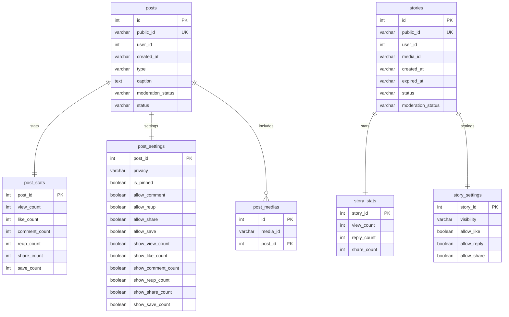

# ContentService — bài viết và tin

**Database:** PostgreSQL `vinasocial_content`. Flyway migrations: `V1__initiate.sql`, `V2__create_stories.sql`.

## ERD

## Mô tả nghiệp vụ

- `posts` chứa tác giả, loại bài, caption, status và moderation status. Settings và stats là bảng 1:1 theo khóa `post_id`.
- `post_medias` lưu thứ tự/liên kết media qua media ID. FK chỉ tới `posts`; `media_id` thuộc MediaService nên không có FK cross-service.
- `stories` trỏ user/media bằng ID logic và có `expired_at`; bảng riêng lưu audience/khả năng like, reply, share và thống kê.
- Feed/profile query cần lọc status, moderation, hạn story và privacy/audience. Một số quyền được kiểm tra qua UserService và RelationshipService.
- Admin routes quản lý trạng thái và moderation cho post/story.

## Ràng buộc và ghi chú

- `public_id` duy nhất cho post/story.
- `post_stats`, `post_settings`, `story_stats`, `story_settings` dùng PK đồng thời làm FK tới entity cha.
- Story stats/settings có `ON DELETE CASCADE`; các FK của post trong migration V1 chưa khai báo cascade.
- `ReelEntity` hiện rỗng và không có bảng/migration Reel trong schema ContentService hiện tại.
