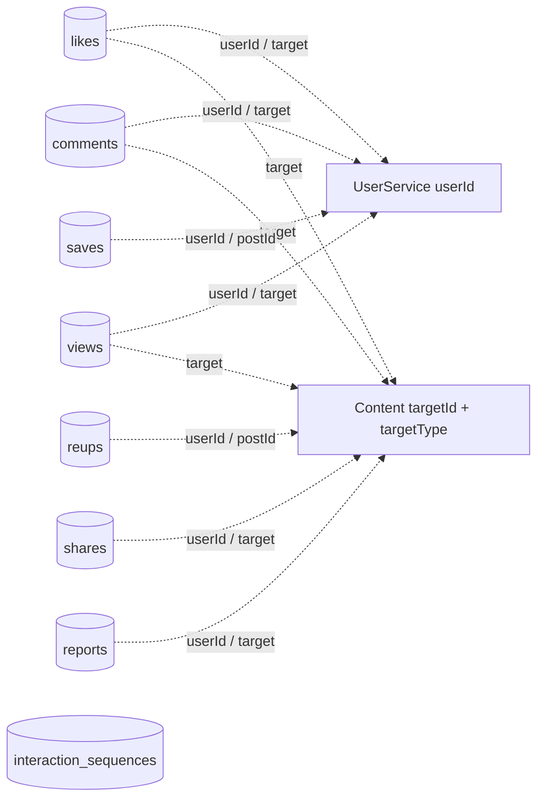

# InteractionService — tương tác

**Database:** MongoDB `vinasocial_interaction`. Các collection được ánh xạ qua `@Document` entities; chưa thấy migration riêng trong source. Index dưới đây lấy từ annotation trên entity.

## Sơ đồ collection

Các cạnh trong sơ đồ là tham chiếu logic, không phải MongoDB foreign key. `CommentMention` là object nhúng trong comment, gồm `userId`, `startIndex`, `endIndex`.

## Collection và dữ liệu

| Collection | Trường nghiệp vụ chính | Ý nghĩa |
|---|---|---|
| `likes` | `id`, `userId`, `targetId`, `targetType`, `createdAt` | Like một target theo loại |
| `comments` | `id`, `userId`, `targetId`, `targetType`, `content`, timestamps, counts, `status`, `hashtagIds`, `mentions[]` | Comment và reply; mention lưu vị trí trong nội dung |
| `views` | `id`, `userId`, `targetId`, `targetType`, `createdAt` | Lượt xem target |
| `saves` | `id`, `userId`, `postId`, `createdAt` | Bài đã lưu |
| `reups` | `id`, `userId`, `postId`, `createdAt` | Bài đăng lại |
| `shares` | `id`, `userId`, `targetId`, `targetType`, `createdAt`, `shareType` | Chia sẻ target |
| `reports` | `id`, `userId`, `targetId`, `targetType`, `createdAt`, `reason`, `status` | Báo cáo target và trạng thái xử lý |
| `interaction_sequences` | `_id`, `value` | Bộ cấp số ID cho entity dùng integer ID |

## Index và quy tắc

- Like duy nhất theo `(userId, targetType, targetId)`; index theo target và thời gian.
- Save và reup duy nhất theo `(userId, postId)`.
- View có index theo target/thời gian và user/target.
- Comment có compound index theo target, status, createdAt và `_id` để phân trang.
- Report có index status/createdAt.
- `userId`, `postId`, `targetId` không ràng buộc FK sang UserService hoặc ContentService; service cần kiểm tra quyền/target qua API nghiệp vụ.
