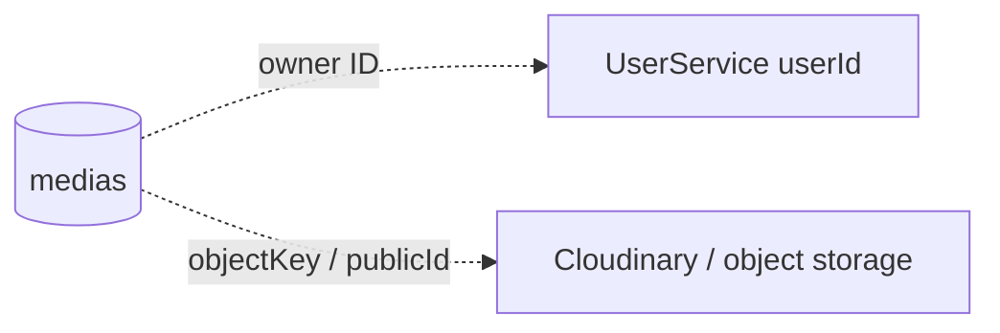

# MediaService — media metadata

**Database:** MongoDB, database mặc định `vinasocial`. Mongock tạo collection `medias`; metadata entity ánh xạ trong `MediaEntity`.

## Sơ đồ collection

## Collection `medias`

| Nhóm | Trường |
|---|---|
| Định danh | `_id`, `user_id`, `created_at` |
| Loại và công dụng | `type`, `provider`, `purpose`, `status` |
| Object storage | `object_key`, `public_id` |
| Tệp | `original_filename`, `content_type`, `width`, `height` |
| Mã hóa | `encryption_mode`, `encryption_algorithm`, `encrypted_iv`, `encryption_aes_key`, `is_encrypted` |

## Mô tả nghiệp vụ

- MediaService tiếp nhận upload, lưu object qua provider cấu hình và metadata trong `medias`.
- `purpose` giúp client/service khác giới hạn loại media dùng vào ngữ cảnh như avatar hoặc nội dung bài viết.
- API `/validate` và `/info` phục vụ các service khác xác minh ownership/purpose/trạng thái và lấy metadata bằng media IDs.
- ID người dùng và tham chiếu media trong ContentService là liên kết logic, không có foreign key liên service.
- `MediaEncryptionKeyEntity` hiện đang bị comment trong source; không tính là collection đã được tạo. Việc có enum `E2EE` trong `encryption_mode` không tự chứng minh luồng client key management đã hoạt động.
