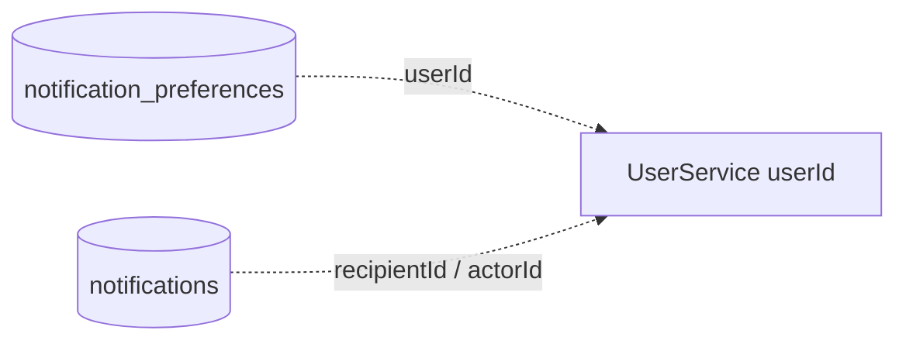

# NotificationService — notification và preference

**Database:** MongoDB `vinasocial_notification`. Mongock tạo `notifications` và `notification_preferences`.

## Sơ đồ collection

Các ID user là tham chiếu logic; MongoDB không có foreign key tới UserService.

## Collection

| Collection | Trường chính | Ý nghĩa |
|---|---|---|
| `notifications` | `_id`, `eventKey`, `recipientId`, `actorId`, `targetId`, `targetType`, `referenceId`, `type`, `title`, `message`, `data`, `status`, `createdAt`, `readAt`, `dismissedAt` | Một notification trong inbox |
| `notification_preferences` | `_id` (userId), các cờ post/story/collaborator/tag/message/follow/replyComment | Cấu hình loại notification được phép |

## Index và nghiệp vụ

- `eventKey` unique, sparse để chống xử lý lặp khi event có idempotency key.
- Compound index inbox theo `(recipientId, status, createdAt desc)`.
- `recipientId` có index cho truy vấn notification của người nhận.
- `notification_preferences` dùng user ID làm `_id`, mỗi user có một document preference.
- NotificationService nhận event từ Kafka, áp dụng preference rồi lưu notification; email/SMS cũng được xử lý bởi consumer/template service.
- REST API cho phép đọc inbox/unread count, đánh dấu một hoặc tất cả đã đọc và xóa notification.
