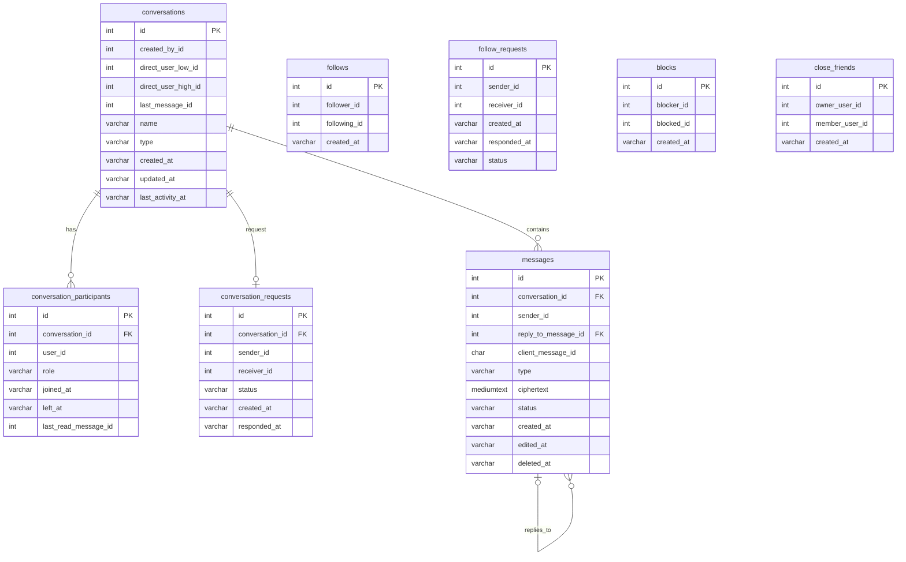

# RelationshipService — social graph và hội thoại

**Database:** MySQL `vinasocial_relationship`. Flyway migrations: social graph ở V1, conversation/message ở V2, seed demo ở V3, read cursor ở V4.

## ERD

User IDs trong social graph, participants, sender/receiver là tham chiếu logic tới UserService; migration không tạo FK cross-service. `last_message_id` và `last_read_message_id` cũng là cursor/ref logic; migration hiện chỉ tạo FK cho `messages.reply_to_message_id`.

## Mô tả nghiệp vụ

- Follow là quan hệ có hướng. `(follower_id, following_id)` là duy nhất; không cho tự theo dõi.
- Follow tài khoản công khai tạo edge ngay. Tài khoản riêng tư tạo `follow_requests` chờ chủ tài khoản chấp nhận; yêu cầu có trạng thái và thời điểm phản hồi.
- Friends được suy ra khi hai chiều follow đều tồn tại; không có bảng friendship riêng.
- Block là có hướng. Theo `DESIGN.md`, block loại bỏ follow hai chiều, hủy follow request hai chiều và xóa membership close-friend hai chiều; message request bị hủy và đọc/gửi bị từ chối khi block còn hiệu lực.
- Close Friends là danh sách do owner quản lý, không phải quan hệ hai chiều và không có yêu cầu tham gia.
- Direct conversation lưu cặp user ID đã sắp xếp low/high để canonicalize và unique. Group conversation không dùng cặp ID này.
- `conversation_participants` lưu role, thời gian tham gia/rời, và `last_read_message_id` để giữ trạng thái đọc theo từng participant.
- Message request có một request cho conversation. Chấp nhận request thêm receiver vào participants và đưa conversation vào inbox.
- Message dùng client-generated UUID để chống tạo trùng theo sender; hỗ trợ reply, edit/delete trạng thái và cursor lịch sử ổn định theo ID.

## Ràng buộc chính

- Unique pair cho follow, follow request, block, close friend và participant/conversation.
- Chỉ một request cho mỗi conversation.
- Direct pair cần `low < high`; group để hai cột direct pair null.
- `messages.conversation_id` cascade khi xóa conversation; reply FK `ON DELETE SET NULL`.
- `lastReadMessageId` là khóa logic, không có FK trong migration V4.
