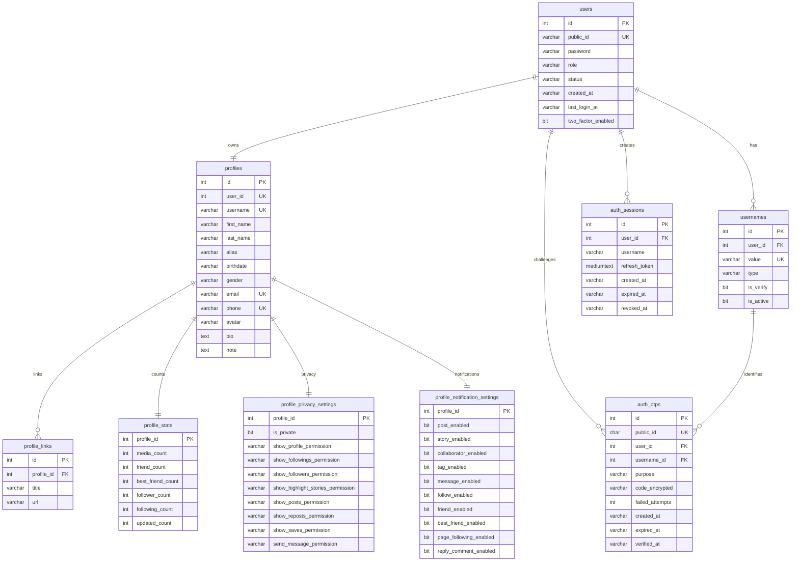

# UserService — dữ liệu tài khoản và hồ sơ

**Database:** MySQL `vinasocial_user`. Schema được khởi tạo bằng Flyway `V1__initiate.sql`; MFA/OTP được cập nhật ở `V2__add_mfa_and_encrypt_auth_otp.sql`.

## ERD

`code_encrypted` là cách gọi mô tả trong sơ đồ; cột thật vẫn tên `auth_otps.code`, được migration V2 nới độ dài để lưu ciphertext.

## Mô tả nghiệp vụ

- `users` là danh tính và thông tin đăng nhập; mỗi user có profile 1:1.
- `usernames` lưu identifier kiểu email, phone hoặc text; mỗi `value` là duy nhất và có trạng thái xác minh/kích hoạt.
- `auth_otps` gắn với user và username, có purpose, hạn dùng, trạng thái xác minh và số lần nhập sai. OTP mới được mã hóa bằng AES-GCM.
- `auth_sessions` theo dõi refresh session, thời hạn và thu hồi.
- `profile_links`, `profile_stats`, `profile_privacy_settings`, `profile_notification_settings` tách dữ liệu phụ khỏi profile chính; các setting/stats dùng `profile_id` làm khóa chính và khóa ngoại.
- Thông tin hồ sơ nhạy cảm được trả khác nhau theo người xem: chi tiết cho chủ tài khoản, trường public đã giới hạn cho người khác.

## Ràng buộc

- `users.public_id`, `profiles.user_id`, `profiles.username`, `usernames.value` là duy nhất.
- Email và phone trong `profiles` có unique constraint nếu có giá trị.
- `auth_otps.purpose` được V2 mở rộng để thêm `ENABLE_MFA` và `DISABLE_MFA`.
- Service khác lưu ID user như dữ liệu tham chiếu; không tạo foreign key từ database khác về `users`.
